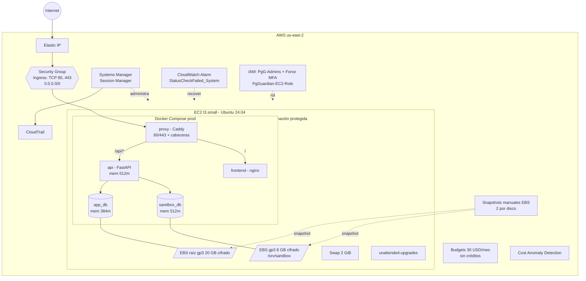
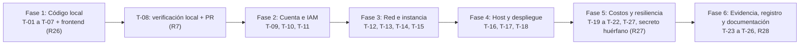

# Documento de Diseño: Despliegue de PgGuardian en AWS (Entregable 2)

## Overview

Este diseño describe cómo cumplir los 28 requisitos de `requirements.md` para desplegar PgGuardian en AWS. La trazabilidad se mantiene como RF → T → CA: cada sección y componente cita los números de *Requirement* (R1 a R28), y las tareas (T-xx) y criterios (CA-xx) que cubre. La matriz completa está en la sección «Matriz de trazabilidad del diseño».

**Decisiones de base (no cambian respecto al E1):**

- Una instancia EC2 `t3.small` (2 vCPU, 2 GiB RAM) con Ubuntu 24.04 en `us-east-2`.
- Docker Compose con cinco contenedores: `proxy` (Caddy), `frontend` (nginx), `api` (FastAPI), `app_db` y `sandbox_db` (PostgreSQL 16). Solo Caddy publica los puertos 80 y 443.
- Elastic IP y dominio `<ip-con-guiones>.sslip.io` (respaldo: DuckDNS).
- Presupuesto de 100 USD en créditos (vencen el 2027-05-11), con un costo estimado 24/7 de unos 22 USD al mes.

**Alcance del trabajo, en tres capas:**

| Capa | Qué se cambia | Requisitos |
| --- | --- | --- |
| Código y configuración del repositorio | `docker-compose.prod.yml`, `Caddyfile`, `backend/api` (health-check), `frontend/src` (llamadas a TiendaDB) | R1 a R7, R26 |
| Infraestructura AWS (consola/CloudShell, sin IaC en el repo) | IAM, EC2, EBS, Security Group, Elastic IP, Budgets, Cost Anomaly Detection, CloudWatch, snapshots manuales de EBS | R8 a R23 |
| Procesos, documentación y evidencia | Registro de decisiones, paquete de evidencia, limpieza de Secrets Manager, secciones del documento fuente | R24, R25, R27, R28 |

**Investigación que informa el diseño** (el contenido se parafrasea de la documentación oficial):

- La sintaxis `${VAR:?mensaje}` de Compose hace que `docker compose config` y `up` fallen con código distinto de 0 cuando la variable falta o está vacía ([Docker: interpolation](https://docs.docker.com/reference/compose-file/interpolation/)). Esto sustenta R1.
- Las anclas y alias YAML con una extensión `x-` permiten compartir un bloque `logging` entre servicios ([Docker: fragments](https://docs.docker.com/reference/compose-file/fragments/)). Sustenta R2.
- Con `HttpTokens=required` en las opciones de metadatos, IMDS rechaza con 401 las solicitudes sin token de sesión ([AWS: IMDSv2](https://docs.aws.amazon.com/AWSEC2/latest/UserGuide/configuring-instance-metadata-service.html)). Sustenta R13.
- Una alarma de CloudWatch sobre `StatusCheckFailed_System` puede usar la acción `arn:aws:automate:<región>:ec2:recover`, que conserva ID de instancia, IP privada, Elastic IP y volúmenes ([AWS: recover](https://docs.aws.amazon.com/AWSEC2/latest/UserGuide/ec2-instance-recover.html)). Sustenta R22.
- Session Manager exige `AmazonSSMManagedInstanceCore` en el rol de la instancia y no necesita puertos de entrada abiertos ([AWS: Session Manager](https://docs.aws.amazon.com/systems-manager/latest/userguide/session-manager.html)). Sustenta R10 y R11.
- En AWS Budgets, `CostTypes` permite excluir créditos y reembolsos (`IncludeCredit=false`, `IncludeRefund=false`) para medir el gasto bruto ([AWS: Budgets CostTypes](https://docs.aws.amazon.com/aws-cost-management/latest/APIReference/API_budgets_CostTypes.html)). Sustenta R20.1.

*Content was rephrased for compliance with licensing restrictions.*

## Architecture

### Vista de despliegue



### Redes Docker

La API es el único servicio conectado a `public_net`, `app_net` y `sandbox_net`. Las bases de datos no comparten red con Caddy. Este aislamiento ya existe en `docker-compose.prod.yml` y el diseño no lo modifica.

### Fases y orden de ejecución



**Decisiones de diseño y justificación:**

| Decisión | Justificación | Requisitos |
| --- | --- | --- |
| Sin SSH ni `.pem`; solo Session Manager | Las IP domésticas cambian, y se evita repartir llaves y abrir el puerto 22. Reemplaza RF-03.3 del E1. | R11, R12, R24.2 |
| Disco EBS dedicado al sandbox | Un script con `generate_series` que llene el disco no debe tumbar `app_db`. Refuerza RF-01.4. | R4, R14, R24.1 |
| `mem_limit` por contenedor (suma 1408 MiB) | Deja al menos 600 MiB del total de 2048 MiB para SO y Docker. | R3 |
| Infraestructura AWS por consola/CloudShell, sin Terraform | Equipo pequeño y 1 entorno. Evita añadir una herramienta y estado remoto. La reproducibilidad se logra con los scripts de creación de `scripts/aws/` y los comandos de verificación de `docs/aws/runbook.md` (C14). | R8 a R23 |
| Presupuesto de 30 USD/mes sin créditos, con 4 alertas | El costo 24/7 estimado de 22 USD al mes cabe en los créditos. Se mide el gasto bruto porque con créditos descontados el gasto sería 0 USD. Reemplaza RF-03.6. | R20, R24.3 |
| Dos snapshots manuales por disco, sin DLM ni prueba de restauración | Basta con un punto de recuperación al estabilizar y otro antes de la demo; evita configurar y pagar una política diaria. | R23, R24.4 |
| Verificación local antes de AWS | Evita llevar regresiones a la instancia. | R7 |

## Components and Interfaces

Cada componente indica su cadena RF → T → CA.

### C1. `docker-compose.prod.yml` (R1, R2, R3, R4)

**Trazabilidad:** RF-04.1 a RF-04.4 · T-01, T-02, T-03, T-04, T-14, T-17 · CA-09, CA-10, CA-11, CA-12, CA-20

Cambios concretos sobre el archivo actual:

```yaml
x-logging: &logging                      # R2 / T-02
  driver: json-file
  options:
    max-size: "10m"
    max-file: "3"

services:
  proxy:    { logging: *logging, ... }   # los cinco servicios
  frontend: { logging: *logging, ... }
  api:
    logging: *logging
    mem_limit: 512m                      # R3 / T-03
    environment:
      JWT_SECRET: ${JWT_SECRET:?falta JWT_SECRET}   # R1 / T-01
  app_db:
    logging: *logging
    mem_limit: 384m
  sandbox_db:
    logging: *logging
    mem_limit: 512m
    volumes:                             # R4 / T-04: sintaxis larga
      - type: bind
        source: ${SANDBOX_DATA_DIR:-./.data/sandbox}
        target: /var/lib/postgresql/data
        bind:
          create_host_path: false
```

- **R1:** hoy `JWT_SECRET: ${JWT_SECRET}` no falla si falta. Se cambia a la forma `:?`. `docker compose config` y `up` terminan con código ≠ 0 antes de crear contenedores.
- **R2:** un único bloque `x-logging` con alias `*logging`; ningún servicio declara un bloque propio.
- **R3:** se usa `mem_limit`, válido en Compose v2. Suma: 512 + 384 + 512 = 1408 MiB. Un OOM de un contenedor no afecta a los demás porque cada uno tiene su propio cgroup.
- **R4:** se elimina el volumen nombrado `sandbox_data` de `volumes:` y de los servicios. El bind mount usa la sintaxis larga, se parametriza con `${SANDBOX_DATA_DIR:-./.data/sandbox}` y declara `bind.create_host_path: false` (R4.1):
  - **Protección contra montaje ausente (R4.8):** con `create_host_path: false`, Docker se niega a iniciar `sandbox_db` si el directorio de origen no existe, tanto en `docker compose up` como en los reinicios automáticos por `restart: unless-stopped`. Con la sintaxis corta, si el disco no se montó, Docker crearía `/srv/sandbox/pgdata` en el disco raíz y PostgreSQL escribiría allí sin aviso. Esta opción es la única protección; la opción `nofail` de `/etc/fstab` (C9) solo garantiza que el SO arranque.
  - **Local (Windows/Docker Desktop):** se usa el valor por defecto `./.data/sandbox`, porque `/srv/sandbox` no existe en el host y la ruta terminaría dentro de la VM de Docker. Como Docker ya no crea la ruta, el script de T-08 (C4) debe crear `./.data/sandbox` antes de `up`. La entrada `.data/` se agrega a `.gitignore` para no versionar esos datos (R4.3).
  - **EC2:** el `.env` define `SANDBOX_DATA_DIR=/srv/sandbox/pgdata` (R4.4). El bind mount apunta al subdirectorio `pgdata`, no a la raíz del volumen, de modo que `lost+found` queda en `/srv/sandbox` y no dentro del directorio de datos de PostgreSQL (R4.2). No hace falta `PGDATA`.
  - **Propietario y montaje (R4.9):** `/srv/sandbox/pgdata` debe existir con propietario UID 999 (usuario `postgres` de la imagen). Se crea únicamente después de confirmar con `findmnt /srv/sandbox` que el volumen está montado; si se creara antes, quedaría en el disco raíz y `create_host_path: false` no protegería nada. Si el volumen no se montó en un arranque posterior, el directorio no existe y Docker no inicia `sandbox_db`.
  - **Riesgo:** si `SANDBOX_DATA_DIR` falta en el `.env` del servidor, el valor por defecto deja los datos de `sandbox_db` en el disco raíz sin ningún aviso. Se mitiga con (a) la comprobación de que `SANDBOX_DATA_DIR=/srv/sandbox/pgdata` en `make_env.sh` y `deploy.sh` (T-17), que fallan si falta o difiere, y en la sección «Host» de `docs/aws/runbook.md`, y (b) CA-12, que con `df -h` sobre la ruta del bind mount debe mostrar el dispositivo del Volumen_Sandbox y no el de `/`.

### C2. `Caddyfile` (R5, R19)

**Trazabilidad:** RF-04.5, RF-06.8, RF-03.4 · T-05, T-06, T-18 · CA-13, CA-23

```caddyfile
{$APP_DOMAIN::80} {
    encode gzip
    header {
        Strict-Transport-Security "max-age=31536000; includeSubDomains"
        X-Content-Type-Options "nosniff"
        X-Frame-Options "DENY"
        Referrer-Policy "strict-origin-when-cross-origin"
        Content-Security-Policy "default-src 'self'; style-src 'self' 'unsafe-inline'; img-src 'self' data:; frame-ancestors 'none'"
        -Server
    }
    handle /api/* { reverse_proxy api:8000 }
    handle        { reverse_proxy frontend:80 }
}
```

- El bloque `header` de Caddy se aplica a todas las respuestas generadas por el proxy, incluidas 4xx y 5xx de Caddy. Para respuestas del *upstream* que ya traigan una de estas cabeceras, se usa el operador `defer`/reemplazo (`header >Nombre`) si la verificación `curl -sI` detecta duplicados, para cumplir «exactamente una vez» (R5.1).
- La CSP inicial es la del R5.3. T-06 es el ciclo de verificación manual: cargar login, registro y análisis, leer la consola y ampliar solo la directiva de la fuente bloqueada, documentando cada cambio (R5.4, R5.5).
- La redirección HTTP→HTTPS y el certificado de Let's Encrypt son comportamiento por defecto de Caddy cuando `APP_DOMAIN` es un nombre de dominio (R19.3, R19.6). Con `APP_DOMAIN` vacío cae al modo `:80` solo para desarrollo local.

### C3. Endpoint `/api/health-check` (R6)

**Trazabilidad:** RF-04.6 · T-07 · CA-14

El endpoint `GET /api/health-check` **ya existe** en `backend/api/main.py` (función `health_check`, sin dependencia de autenticación, R6.5). El cambio consiste en **modificar ese manejador**, no en añadir uno nuevo. Hoy devuelve `status`, `database`, `target`, `pg_version`, `error` y `timestamp`, lo que filtra información interna. No hay colisión con el router de salud, que usa el prefijo `/api/health`: son rutas distintas.

Se conserva la bifurcación actual por la variable `DB_HOST`:

- **Producción (`DB_HOST` no definida):** `connect_app_db(connect_timeout=2)` de `backend/services/analysis_store.py`, que usa las variables `APP_DB_*`.
- **Local (`DB_HOST` definida):** `get_connection()` de `backend/api/database.py`, que apunta a TiendaDB. Esa función no define `connect_timeout`, y en producción el contenedor TiendaDB no existe, por lo que **no debe usarse en la ruta de producción**: el health-check respondería siempre error.

```python
# backend/services/analysis_store.py: único cambio fuera de main.py
def connect_app_db(connect_timeout: int = 10):      # default = comportamiento actual
    conn = psycopg2.connect(
        ...,                                         # APP_DB_* sin cambios
        connect_timeout=connect_timeout,
    )
    conn.autocommit = True
    return conn
```

```python
# backend/api/main.py
@app.get("/api/health-check")
def health_check():
    conn_gen = None
    conn = None
    try:
        if os.getenv("DB_HOST"):                     # local: TiendaDB
            conn_gen = get_connection()
            conn = next(conn_gen)
        else:                                        # producción: app_db
            conn = connect_app_db(connect_timeout=2)
        with conn.cursor() as cur:
            cur.execute("SELECT 1")
        return {"status": "ok"}
    except Exception as exc:                         # cualquier fallo
        logger.error(
            "health-check falló [%s]: %s: %s",
            datetime.now(timezone.utc).isoformat(), type(exc).__name__, exc,
        )
        return JSONResponse({"status": "error"}, status_code=503)
    finally:
        if conn_gen is not None:
            conn_gen.close()
        elif conn is not None:
            conn.close()
```

| Situación | Respuesta | Log del servidor |
| --- | --- | --- |
| `SELECT 1` en ≤ 2 s | `{"status":"ok"}` | Ninguno |
| App_DB sin respuesta en 2 s o rechaza conexión | `{"status":"error"}` | Marca de tiempo, tipo de excepción y mensaje |
| Excepción no controlada | `{"status":"error"}` | Igual |

Contrato: la respuesta contiene **únicamente** la clave `status`. El código HTTP en error es 503 (la fuente no lo fija; se deja como decisión de diseño para que Docker/ALB puedan usarlo). En la ruta de producción el tiempo total se mantiene ≤ 3 s gracias a `connect_timeout=2` (la consulta `SELECT 1` es trivial). La rama local (`get_connection()`) no tiene timeout propio; el requisito de ≤ 3 s se garantiza solo en producción. Ambas ramas responden únicamente `{"status": ...}`, mantienen `SELECT 1` y cierran la conexión en `finally`, como hoy.

*Nota de implementación:*

- `connect_app_db` pasa de `def connect_app_db()` a `def connect_app_db(connect_timeout: int = 10)`. El valor por defecto preserva el comportamiento actual, de modo que los demás llamadores (`_connect_app_db = connect_app_db`, `init_app_db_schema`, etc.) no cambian.
- El test existente `backend/tests/test_rnf.py::test_rf03_health_check_uses_app_db_without_db_host_and_tiendadb_when_set` valida campos como `target` y los de versión de PostgreSQL, que desaparecen con la respuesta saneada. Debe actualizarse: la rama invocada se verifica con los mocks `mock_app_db` y `mock_tienda`, y la respuesta se compara solo con `{"status": "ok"}`.

### C4. Verificación local (R7)

**Trazabilidad:** RNF-05 · T-08 · CA-09 a CA-14 (local)

Un script `scripts/verify_phase1.ps1` / `.sh` que:

0. **Precondiciones:** verifica que existe el `.env` local y que `JWT_SECRET` no está vacío. Si no, se detiene antes de levantar contenedores, indica qué falta (el archivo `.env` o `JWT_SECRET`) y cómo corregirlo, y sale con código ≠ 0 (R7.1).
0b. **Directorio de datos del sandbox (R7.2, R7.3):** crea `./.data/sandbox` (o la ruta de `SANDBOX_DATA_DIR` si el `.env` la define) si no existe, porque `create_host_path: false` impide que Docker lo cree. Si no puede crearlo, se detiene antes de levantar contenedores, indica la ruta y la causa, y sale con código ≠ 0.
1. Ejecuta `docker compose -f docker-compose.prod.yml up -d --build` y espera hasta 120 s a que los cinco servicios estén `running`/`healthy`. Se usa el archivo de producción porque `docker compose up -d` a secas solo levanta el compose de desarrollo con TiendaDB.
2. Llama al health-check de la API (timeout 5 s).
3. Ejecuta las verificaciones locales de CA-09 a CA-14 e imprime una tabla aprobado/no aprobado. CA-09 se verifica ejecutando `docker compose -f docker-compose.prod.yml config` con `JWT_SECRET` vacío solo en el entorno del proceso (sin modificar el `.env`); aprueba únicamente si el comando termina con código ≠ 0 y muestra «falta JWT_SECRET».
4. Sale con código ≠ 0 si algo falla; el equipo no abre el PR hasta que los seis criterios pasan. El resultado impreso se pega en la descripción del PR.

**Riesgo de T-08 (Docker Desktop sobre Windows):** con el valor por defecto `./.data/sandbox`, el bind mount cae en un sistema de archivos NTFS, y PostgreSQL puede no lograr cambiar los permisos de su directorio de datos. Si `sandbox_db` no llega a `healthy` en 120 s, T-08 lo detecta como fallo y debe resolverse antes de abrir el PR. No se resuelve modificando el compose en silencio: cualquier cambio se discute y se documenta.

Correspondencia con R7: pasos 0 y 0b → R7.1 a R7.3; paso 1 → R7.4; paso 2 → R7.5; paso 3 → R7.6; paso 4 → R7.7 y R7.8.

### C5. Identidad y acceso (R8, R9, R10, R11)

**Trazabilidad:** RF-05.1 a RF-05.5 · T-09, T-10, T-11, T-13, T-16 · CA-15, CA-16, CA-17, CA-18

| Recurso | Configuración | Requisito |
| --- | --- | --- |
| Cuenta raíz | MFA activo, 0 access keys, acceso IAM a facturación activado. `get-account-summary` debe dar `AccountMFAEnabled=1` y `AccountAccessKeysPresent=0`. | R8 |
| Usuarios IAM | Uno por integrante, sin access keys; CLI solo desde CloudShell. | R9.1, R9.4 |
| Grupo `PgG-Admins` | `AdministratorAccess` + política `Force_MFA`; tiene como miembros a los integrantes del Equipo. | R9.3, R24.5 |
| Política `Force_MFA` | `Deny` con `NotAction` sobre las acciones de autogestión de contraseña y MFA, con condición `BoolIfExists: aws:MultiFactorAuthPresent = false`. Con MFA autenticado, la condición no aplica y rigen los permisos del grupo. | R9.2, R9.6 |
| Rol `PgGuardian-EC2-Role` | Política administrada `AmazonSSMManagedInstanceCore`; perfil de instancia asociado. Sin claves en disco. | R10 |

Esqueleto de `Force_MFA`:

```json
{
  "Version": "2012-10-17",
  "Statement": [{
    "Sid": "DenyAllExceptSelfServiceWithoutMFA",
    "Effect": "Deny",
    "NotAction": [
      "iam:ChangePassword", "iam:GetUser",
      "iam:CreateVirtualMFADevice", "iam:EnableMFADevice",
      "iam:ListMFADevices", "iam:ListVirtualMFADevices",
      "iam:ResyncMFADevice", "sts:GetSessionToken"
    ],
    "Resource": "*",
    "Condition": { "BoolIfExists": { "aws:MultiFactorAuthPresent": "false" } }
  }]
}
```

Las acciones IAM de autogestión deben limitarse además al propio usuario mediante `arn:aws:iam::<cuenta>:user/${aws:username}` en una declaración `Allow` separada.

**Verificación de CA-16:** no se crea ningún usuario de prueba sin MFA. CA-16 se verifica con el reporte de credenciales de IAM (R9.5) y con la revisión de la definición de `Force_MFA` adjunta al grupo. Esta desviación queda en el Registro_Decisiones (R24.6).

**Session Manager (R11):** la instancia se lanza sin `KeyName` (R11.2). CloudTrail registra `StartSession` automáticamente; la verificación consiste en abrir una sesión con un Usuario_IAM y buscar el evento con `aws cloudtrail lookup-events --lookup-attributes AttributeKey=EventName,AttributeValue=StartSession`, con hasta 15 min de retraso (R11.3). La verificación del acceso sin SSH (R11.4) usa `aws ec2 describe-instances` (campo `KeyName` vacío o ausente) y `aws ec2 describe-security-groups` (ninguna regla de entrada TCP/22).

### C6. Red: Security Group (R12)

**Trazabilidad:** RF-06.1 · T-12 · CA-18

| Dirección | Protocolo/Puerto | Origen | Cantidad de reglas |
| --- | --- | --- | --- |
| Ingress | TCP 80 | `0.0.0.0/0` | 1 |
| Ingress | TCP 443 | `0.0.0.0/0` | 1 |
| Egress | todo | `0.0.0.0/0` | 1 (necesario para Let's Encrypt, apt, SSM y pull de imágenes) |

Exactamente dos reglas de entrada, ninguna para el puerto 22 ni para `::/0` (R11.1, R12.2). Verificación: `aws ec2 describe-security-groups` y `nmap -Pn -p- <eip>` (R12.3).

### C7. Instancia EC2 y volúmenes (R10, R13, R14, R16, R17)

**Trazabilidad:** RF-05.4, RF-06.2, RF-06.3, RF-06.5, RF-06.6 · T-13, T-14 · CA-17, CA-19, CA-20, CA-21

| Atributo | Valor | Requisito |
| --- | --- | --- |
| AMI / tipo | Ubuntu 24.04 / `t3.small` | base |
| Perfil IAM | `PgGuardian-EC2-Role` | R10 |
| Par de llaves | ninguno | R11.2 |
| Metadatos | `HttpTokens=required`, `HttpEndpoint=enabled`, `HttpPutResponseHopLimit=1` | R13 |
| Disco raíz | gp3, 20 GB, `Encrypted=true` | R14.1 |
| Volumen sandbox | gp3, 8 GB, `Encrypted=true`, dispositivo aparte | R14.2 |
| Protección | `disableApiTermination=true` | R16 |
| Etiquetas | `Project=PgGuardian`, `Env=prod`, `Owner=<1..256 chars>` en instancia, discos y Elastic IP | R17 |

Para que las etiquetas queden también en los volúmenes y la Elastic IP, se usa `--tag-specifications` para `instance`, `volume` y (al asignarla) `elastic-ip` (R17.2). Si `Owner` es inválido, se corrige solo esa etiqueta (R17.3).

**IMDSv2 y contenedores (R13):** con `HttpPutResponseHopLimit=1`, la respuesta al `PUT` del token no cruza el salto adicional de la red bridge de Docker, así que un contenedor comprometido no puede obtener credenciales del Rol_EC2 por SSRF. La verificación se hace desde un contenedor con `docker run --rm` y `curl` con `PUT http://169.254.169.254/latest/api/token` (timeout de 5 s); la solicitud debe fallar o agotar el tiempo. El agente SSM corre en el host (no en un contenedor), por lo que no se ve afectado y la instancia sigue apareciendo `Online` en Systems Manager.

### C8. Elastic IP y dominio (R19)

**Trazabilidad:** RF-06.8, RF-03.1, RF-03.4, RF-03.5 · T-15, T-17, T-18 · CA-23

1. T-15: asignar y asociar la Elastic IP.
2. T-17: crear `.env` con permisos `600`, `APP_DOMAIN=<a-b-c-d>.sslip.io` (IP con guiones), `JWT_SECRET` aleatorio (`openssl rand -hex 32`, 64 hex = 32 bytes, R1.4) y `SANDBOX_DATA_DIR=/srv/sandbox/pgdata` (R4.4). Antes de `up`, el despliegue comprueba que `SANDBOX_DATA_DIR` está definida con ese valor.
3. T-18: `docker compose -f docker-compose.prod.yml up -d --build`. Se espera un certificado en ≤ 120 s. Si falla (límites de Let's Encrypt para `sslip.io` son un riesgo real, por ser un dominio compartido), se pasa al respaldo DuckDNS y se vuelve a ejecutar `up -d` (R19.4).
4. Si tampoco se obtiene certificado, Caddy rechaza HTTPS y no sirve HTTP en claro; el error se lee con `docker logs pgguardian_proxy` (R19.7).

### C9. Configuración del host Ubuntu (R4, R14, R15, R18)

**Trazabilidad:** RF-04.4, RF-06.3, RF-06.4, RF-06.7, RF-05.5 · T-14, T-16 · CA-12, CA-20, CA-22

Un script `scripts/aws/bootstrap_host.sh`, idempotente, ejecutado por Session Manager:

| Paso | Detalle | Requisito |
| --- | --- | --- |
| Volumen sandbox | `mkfs.ext4` solo si no tiene sistema de archivos; entrada en `/etc/fstab` por UUID con `nofail`; montar; comprobar `findmnt /srv/sandbox` y, **solo si el montaje está confirmado**, ejecutar `mkdir -p /srv/sandbox/pgdata` y `chown 999:999 /srv/sandbox/pgdata`. Si la comprobación falla, el script se detiene sin crear el directorio. | R4.5, R4.6, R4.7, R4.9 |
| Swap | `/swapfile` de 2 GiB (`fallocate`, `chmod 600`, `mkswap`), entrada en `/etc/fstab`. El script verifica con `swapon --show` y no duplica áreas en reinicios repetidos. | R15 |
| Parches | `apt install unattended-upgrades`; `/etc/apt/apt.conf.d/20auto-upgrades` con `Update-Package-Lists "1"` y `Unattended-Upgrade "1"`; solo el origen `-security`. | R18 |
| Docker | Instalación de Docker Engine y plugin Compose. | base |

Si el Volumen_Sandbox falta en un arranque, `nofail` permite que el SO termine de arrancar y `create_host_path: false` (C1) impide que `sandbox_db` arranque y escriba en el disco raíz (R4.8). No hay unidad systemd adicional.

### C10. Costos (R20, R21)

**Trazabilidad:** RF-07.1, RF-07.2 · T-19, T-20 · CA-24

- **Presupuesto:** `scripts/aws/create_budget.sh` ejecuta `aws budgets create-budget` con monto 30.00 USD, `TimeUnit=MONTHLY`, `BudgetType=COST` y `CostTypes` con `IncludeCredit=false` e `IncludeRefund=false` (R20.1). El motivo: la cuenta usa créditos, y con los créditos descontados el gasto real sería 0 USD y ninguna alerta se dispararía; sin ellos, el Presupuesto mide el gasto bruto. Cuatro notificaciones: ACTUAL 50 %, 80 %, 100 % y FORECASTED 100 % (R20.2, R20.3). Entre 1 y 5 suscriptores de correo (R20.4).

  ```json
  "CostTypes": { "IncludeCredit": false, "IncludeRefund": false }
  ```

- **Verificación:** comandos de la sección «Costos» de `docs/aws/runbook.md` que leen el presupuesto (`describe-budget`, incluido `CostTypes`) y comparan con las cuatro notificaciones esperadas (`describe-notifications-for-budget`); el Equipo anota faltantes o sobrantes (R20.5, R20.7).
- **Cost Anomaly Detection:** `scripts/aws/create_anomaly_detection.sh` crea un monitor `DIMENSIONAL` de servicio (1 a 10 monitores) y una suscripción de correo con frecuencia `IMMEDIATE`. Si la suscripción no se confirma, el estado del monitor lo indica (R21.3).

### C11. Resiliencia y respaldos (R22, R23)

**Trazabilidad:** RF-07.3, RF-07.4 · T-21, T-22, T-27 · CA-25, CA-26

| Componente | Configuración | Requisito |
| --- | --- | --- |
| Alarma `Alarma_Recover` | `StatusCheckFailed_System`, `Maximum`, período 60 s, umbral ≥ 1, 2 períodos, `TreatMissingData=notBreaching`, acción `arn:aws:automate:us-east-2:ec2:recover`. | R22 |
| Snapshot de estabilización | Al alcanzar el estado estable (App_DB y la aplicación pasan sus verificaciones de salud durante al menos 5 min seguidos), un Snapshot_Manual del disco raíz (contiene `app_db`) y uno del Volumen_Sandbox. | R23.1 |
| Snapshot previo a la demo | 24 h o menos antes de la demo, un segundo Snapshot_Manual de cada disco. | R23.2 |
| Verificación | Cada snapshot se verifica solo por estado `completed` (`aws ec2 describe-snapshots`), sin restaurarlo. | R23.3 |
| Reintento | Si un snapshot termina en `error`, se repite el del mismo volumen hasta obtener `completed`. | R23.4 |

`scripts/aws/manual_snapshot.sh` recibe el volumen (raíz o sandbox), crea el snapshot con las etiquetas `Project`, `Env` y `Owner`, y espera con `aws ec2 wait snapshot-completed`. Si termina en `error`, el Equipo lo vuelve a ejecutar para ese volumen. En total quedan cuatro snapshots: dos del disco raíz y dos del Volumen_Sandbox. `app_db` vive en el volumen nombrado `pgguardian_app_data` del disco raíz, así que sus datos quedan dentro del snapshot del raíz. No hay política de DLM ni prueba de restauración; la desviación queda en el Registro_Decisiones (R24.4).

### C12. Procesos y documentación: registro de decisiones, evidencia, secreto huérfano y documento fuente (R24, R25, R27, R28)

**Trazabilidad:** RF-08.1, RF-08.2 · T-23, T-24, T-25, T-26, tarea manual (R27), tarea de documentación (R28) · CA-27 (y CA-01 a CA-08 del E1)

- **Registro_Decisiones** (`docs/aws/decision-log.md`): una tabla con siete entradas y los campos de R24.1:

| Entrada | Requisito afectado | Requisito |
| --- | --- | --- |
| Disco propio del sandbox | RF-01.4 | R24.1 |
| Session Manager con puerto 22 cerrado | RF-03.3 | R24.2 |
| Control de gasto con Budgets | RF-03.6 | R24.3 |
| Dos snapshots manuales por disco, sin DLM ni prueba de restauración | RF-07.4, CA-26 | R24.4 |
| `PgG-Admins` con los integrantes del Equipo como miembros | RF-05.3 | R24.5 |
| CA-16 sin prueba de usuario sin MFA | CA-16 | R24.6 |
| Llamadas del Frontend a endpoints de TiendaDB | «hallazgo del despliegue, sin RF ni CA en la fuente» | R24.7 |

  La aprobación de cada entrada (nombre y fecha AAAA-MM-DD) se anota en la especificación en ≤ 2 días hábiles (R24.8). Una entrada sin campos completos o sin aprobación cuenta como no aprobada, y T-26 no se cierra (R24.9).

- **Paquete_Evidencia** (`docs/aws/evidencia/`):

| Artefacto | Origen | Requisito |
| --- | --- | --- |
| `zap-baseline-<fecha>.html` | `scripts/aws/run_zap.sh` (`docker run ghcr.io/zaproxy/zaproxy:stable zap-baseline.py -t https://<dominio> -r ...`) | R25.1, R25.2 |
| `nmap-<fecha>.txt` | `scripts/aws/run_nmap.sh` (`nmap -Pn -p 1-65535 <eip>`) | R25.3, R25.4 |
| `justificaciones.md` | Solo si quedan hallazgos medios/altos o puertos extra | R25.2, R25.4 |
| `ca-01..ca-08/` | Capturas con la URL pública y resultado | R25.5 |

- **Secreto huérfano (R27):** tarea manual descrita en la sección «Costos» de `docs/aws/runbook.md`. El Equipo lista los secretos con `aws secretsmanager list-secrets --region us-east-2`, identifica el Secreto_Huerfano y confirma que no se usa (fecha de último acceso y búsqueda del nombre o ARN en el código, en `docker-compose.prod.yml` y en el `.env` de la Instancia). Solo entonces ejecuta `aws secretsmanager delete-secret --secret-id <arn> --recovery-window-in-days <7..30>`, nunca con `--force-delete-without-recovery`. Si no puede confirmarlo, conserva el secreto y registra el motivo (R27.4).
- **Documento fuente (R28):** el Equipo redacta en `PgGuardian - Requisitos del Entregable 2 (AWS).md` tres secciones: alcance del E2, plan de trabajo y proceso estándar.

### C13. Frontend sin llamadas a endpoints de TiendaDB (R26)

**Trazabilidad:** hallazgo del despliegue, sin RF ni CA en la fuente · tarea nueva de la Fase 1 (sin T-xx) · registro en R24.7

Situación actual: `frontend/src/App.jsx` llama a `fullScan()` al iniciar sesión (efecto inicial, línea 131) y en `runScan` (línea 114). `frontend/src/api/pgguardian.js` define `fullScan` (`/full-scan`) y funciones para los routers `/bloat`, `/config`, `/health`, `/indexes` y `/queries`. En el backend esos endpoints usan `get_connection()`, que conecta a TiendaDB, y en producción TiendaDB no existe, así que fallarían al iniciar sesión.

Diseño:

1. **Revisión (R26.1):** listar qué funciones de `pgguardian.js` de esos seis prefijos se invocan desde componentes (búsqueda de sus nombres en `frontend/src`) y anotar el resultado en la entrada R24.7 del Registro_Decisiones.
2. **Retiro en producción (R26.2):** las llamadas que se ejecuten se condicionan a una variable de build de Vite, `VITE_ENABLE_TIENDADB_SCAN`. Solo con el valor `"true"` se ejecutan `fullScan()` y los detectores; el build de producción no la define, así que el código no hace esas solicitudes. Esto aplica al efecto inicial y a `runScan` de `App.jsx`, y a cualquier otra llamada que aparezca en la revisión. Los controles de escaneo de la pestaña local se ocultan cuando la variable no está activa, para no mostrar un botón que no hace nada.
3. **Fuera de alcance:** `/api/health-check` (`healthCheck` en `pgguardian.js`) se mantiene, porque usa App_DB en producción (C3). Las funciones de `pgguardian.js` no se borran, para no romper el entorno de desarrollo con TiendaDB.
4. **Verificación (R26.3):** con el build de producción, iniciar sesión y recorrer login, registro y análisis con la pestaña Red abierta: 0 solicitudes a `/api/full-scan`, `/api/bloat`, `/api/config`, `/api/health/`, `/api/indexes` y `/api/queries`.

### C14. Scripts y runbook (transversal, R8 a R23)

Solo son obligatorios los scripts que crean o modifican recursos. Las verificaciones son comandos dentro de un único documento.

| Tipo | Archivos |
| --- | --- |
| Scripts de creación (`scripts/aws/`) | `setup_iam.sh`, `create_ec2_role.sh`, `create_security_group.sh`, `launch_instance.sh`, `create_sandbox_volume.sh`, `allocate_eip.sh`, `bootstrap_host.sh`, `make_env.sh`, `deploy.sh`, `create_budget.sh`, `create_anomaly_detection.sh`, `create_recover_alarm.sh`, `manual_snapshot.sh` |
| Scripts de evidencia (`scripts/aws/`) | `run_zap.sh`, `run_nmap.sh` |
| Verificación local (Fase 1) | `scripts/verify_phase1.sh` / `.ps1` (C4) |
| Runbook único | `docs/aws/runbook.md`, con secciones: raíz/IAM, instancia, host, despliegue, costos (incluye el secreto huérfano) y snapshots |

Cada sección del runbook contiene los comandos de verificación del criterio correspondiente y el resultado esperado en el formato de «Resultado de verificación» (Data Models). Los pasos manuales (MFA de la cuenta raíz, acceso IAM a facturación, prueba de reinicio sin volumen) también van en el runbook.

### Mejoras futuras

El grupo de operadores, el `pg_dump` periódico de App_DB y las demás pruebas retiradas no forman parte de este diseño; se listan en la sección «Mejoras futuras» de `requirements.md`.

## Data Models

No hay cambios en el esquema de base de datos de la aplicación. Los modelos relevantes son de configuración y de evidencia.

### Variables de entorno (`.env` en la instancia, permisos 600)

| Variable | Obligatoria | Origen / regla | Requisito |
| --- | --- | --- | --- |
| `APP_DOMAIN` | Sí | `<a-b-c-d>.sslip.io` | R19.2 |
| `JWT_SECRET` | Sí (falla si falta) | `openssl rand -hex 32` | R1 |
| `SANDBOX_DATA_DIR` | Local: opcional (default `./.data/sandbox`). Producción: obligatoria | `/srv/sandbox/pgdata` en la EC2; sin ella los datos quedan en el disco raíz | R4 |
| `APP_DB_NAME/USER/PASSWORD` | Sí | secretos aleatorios | base |
| `SANDBOX_DB_*` | Sí | secretos aleatorios | base |
| `CORS_ORIGINS` | Sí | `https://<APP_DOMAIN>` | base |
| `COOKIE_SECURE`, `TRUST_PROXY_HEADERS` | Sí | `true` | base |

El archivo `.env` no contiene claves de acceso de AWS (R10.2). `.env.prod.example` debe actualizarse con `JWT_SECRET` documentado como obligatorio y con `SANDBOX_DATA_DIR=/srv/sandbox/pgdata` documentado como obligatorio en producción.

### Variable de build del Frontend

| Variable | Valor en producción | Efecto | Requisito |
| --- | --- | --- | --- |
| `VITE_ENABLE_TIENDADB_SCAN` | sin definir | No se ejecutan `fullScan()` ni los detectores de TiendaDB | R26.2 |

### Etiquetas de recursos AWS

```text
Project = PgGuardian
Env     = prod
Owner   = <cadena de 1 a 256 caracteres>
```

Se aplican a instancia, disco raíz, Volumen_Sandbox, Elastic IP y snapshots manuales.

### Entrada del Registro_Decisiones

| Campo | Formato |
| --- | --- |
| `requisito_afectado` | p. ej. `RF-01.4`, o «hallazgo del despliegue, sin RF ni CA en la fuente» |
| `cambio` | texto |
| `justificacion` | texto (las de R24.1 a R24.3 están fijadas) |
| `fecha` | `AAAA-MM-DD` |
| `aprobador` | nombre; ausente = decisión no aprobada |

### Resultado de verificación (común al script local y al runbook)

```json
{ "criterio": "CA-10", "requisito": "R2", "estado": "aprobado|no_aprobado|no_verificable", "detalle": "..." }
```

`scripts/verify_phase1` emite una línea por criterio con esta forma para pegarla en el PR (R7.8). Para las verificaciones del runbook, el Equipo anota el resultado con la misma forma en el paquete de evidencia (R25).

## Error Handling

| Escenario | Comportamiento | Requisito |
| --- | --- | --- |
| `JWT_SECRET` ausente o vacío | `config`/`up` fallan con código ≠ 0 y mensaje «falta JWT_SECRET»; ningún contenedor se crea. | R1.2, R1.3 |
| Servicio no resuelve la política de logs | La verificación de CA-10 falla e identifica el servicio. | R2.5 |
| Contenedor excede `mem_limit` | OOM kill solo de ese contenedor; `docker inspect` muestra `OOMKilled=true`; `restart: unless-stopped` lo reinicia. | R3.5 |
| Volumen sandbox ausente al arrancar | El SO arranca gracias a `nofail`. `sandbox_db` no inicia: Docker rechaza el bind mount (`create_host_path: false`) sin crear la ruta, de modo que no escribe en el disco raíz. | R4.8 |
| `/srv/sandbox` no montado al ejecutar el bootstrap | `bootstrap_host.sh` se detiene sin crear `/srv/sandbox/pgdata`. | R4.9 |
| `SANDBOX_DATA_DIR` falta o difiere en el servidor | `make_env.sh` y `deploy.sh` fallan antes de `up`. | R4.4 |
| Directorio de datos local inexistente al ejecutar T-08 | El script lo crea antes de `up`; si no puede, se detiene con la ruta y la causa y sale con código ≠ 0. | R7.2, R7.3 |
| `.env` local o `JWT_SECRET` ausente en T-08 | El script se detiene antes de levantar contenedores, indica qué falta y sale con código ≠ 0. | R7.1 |
| Violación de CSP | Se amplía solo la directiva afectada y se documenta. | R5.5 |
| App_DB caída o lenta | Health-check responde `{"status":"error"}` sin detalles; el detalle va al log. | R6.2–R6.4 |
| Fallo en verificación local | No se abre el PR; se registra el servicio o criterio fallido, se corrige y se repite la verificación completa. | R7.7 |
| Cuenta raíz no conforme / consulta falla | Se marca no conforme (indicando la condición) o no verificable (con causa); nunca aprobado; la verificación no modifica la cuenta. | R8.5, R8.6 |
| Sesión de Usuario_IAM sin MFA | `Force_MFA` deniega todo salvo la autogestión de contraseña y MFA. | R9.2 |
| Instancia no aparece `Online` en SSM en 300 s | Se reporta fallo sin modificar rol ni recursos. | R10.4 |
| Intento de SSH | Sin respuesta (SG descarta). | R11.5, R12.4 |
| Token IMDS ausente, inválido o expirado | HTTP 401 sin contenido. | R13.2, R13.4 |
| Contenedor pide token IMDS | Falla o agota el tiempo en ≤ 5 s por el hop limit 1. | R13.5 |
| Instancia no vuelve a `running` en 300 s | Datos de ambos volúmenes intactos; R14.3 se marca fallido. | R14.4 |
| Swap no se activa | Arranque continúa, se registra error en syslog. | R15.4 |
| Terminación solicitada | Rechazada por `disableApiTermination`. | R16.3 |
| `Owner` inválido | Recurso no conforme; se corrige solo la etiqueta. | R17.3 |
| Parche falla | Error en `/var/log/unattended-upgrades/unattended-upgrades.log`; sin rollback. | R18.5 |
| Certificado `sslip.io` no se emite en 120 s | Respaldo DuckDNS; si falla, HTTPS rechazado y error en logs de Caddy. | R19.4, R19.7 |
| Presupuesto con ≠ 4 notificaciones | No conforme; se informan las diferencias. | R20.7 |
| Suscripción de anomalías sin confirmar | La anomalía se conserva y el estado del monitor refleja el fallo. | R21.3 |
| Datos faltantes en `StatusCheckFailed_System` | `notBreaching`; sin acción. | R22.3 |
| Snapshot manual en estado `error` | Se repite el snapshot del mismo volumen hasta obtener `completed`. | R23.4 |
| ZAP con hallazgos medios/altos | Se corrigen y repiten, o se justifican por escrito. | R25.2 |
| `nmap` muestra puertos extra | Se cierran o se justifican por escrito. | R25.4 |
| Entrada del registro sin campo o aprobación | Decisión no aprobada; T-26 no se cierra. | R24.9 |
| Frontend de producción llama a un endpoint de TiendaDB | Se retira la llamada (variable de build) y se registra en R24.7. | R26.2 |
| No se puede confirmar que el secreto no se usa | Se conserva el secreto y se registra el motivo. | R27.4 |

## Testing Strategy

### Por qué no se incluyen propiedades de corrección (PBT)

Se omite la sección *Correctness Properties* y no se usan pruebas basadas en propiedades. La mayor parte del alcance es infraestructura como configuración (Compose, Caddy, IAM, EC2, EBS, Budgets, CloudWatch, snapshots), donde no existe una función con entradas y salidas sobre las que enunciar un «para todo X». La única lógica de código nuevo (`/api/health-check`) tiene tres ramas fijas (ok, error por base de datos, error por excepción) que se cubren mejor con ejemplos y mocks; ejecutar 100 iteraciones no encontraría más fallos que 3 ejemplos. El cambio del Frontend (R26) es un condicional sobre una variable de build y se verifica con un ejemplo en el navegador.

### Pruebas unitarias y de ejemplo (código)

| Prueba | Qué verifica | Requisito |
| --- | --- | --- |
| `test_health_check_ok` | Con la conexión simulada exitosa, responde `{"status":"ok"}` y nada más. | R6.1 |
| `test_health_check_db_down` | Con `OperationalError`, responde `{"status":"error"}` sin detalles y registra tipo y mensaje. | R6.2, R6.4 |
| `test_health_check_timeout` | Con espera simulada > 2 s, responde error en ≤ 3 s. | R6.2 |
| `test_health_check_unexpected` | Con `RuntimeError`, el cuerpo no contiene el texto de la excepción. | R6.3 |
| `test_health_check_no_auth` | Sin cabecera/cookie de autenticación se procesa la solicitud. | R6.5 |

Se escriben como métodos de una clase `unittest.TestCase` (con `unittest.mock` para las conexiones) en `backend/tests/`, igual que las pruebas existentes; `pytest` no está en `backend/requirements.txt`. Se ejecutan con `python -m unittest` desde `backend/`.

### Pruebas de configuración (smoke y esquema)

Las verificaciones automatizables de `docker-compose.prod.yml` (T-1.9) también son `unittest.TestCase`. La clase se decora con `@unittest.skipUnless(shutil.which("docker"), "docker no está instalado")` para que se omita en máquinas sin Docker.

| Verificación | Comando / método | Requisito · CA |
| --- | --- | --- |
| Falla sin `JWT_SECRET` | `JWT_SECRET= docker compose -f docker-compose.prod.yml config` → código ≠ 0 | R1 · CA-09 |
| Logging común | `docker compose ... config` y revisión de los cinco servicios; `docker inspect -f '{{.HostConfig.LogConfig}}'` | R2 · CA-10 |
| Límites de memoria | `docker stats --no-stream` | R3 · CA-11 |
| Bind mount con sintaxis larga | `docker compose -f docker-compose.prod.yml config` muestra `create_host_path: false` en el bind de `sandbox_db` | R4.1 · CA-12 |
| `.gitignore` | Contiene `.data/` | R4.3 |
| Volumen ausente (manual, EC2; sección «Host» del runbook) | No montar o desmontar el volumen y reiniciar la instancia: el SO arranca, `sandbox_db` no arranca y `/srv/sandbox/pgdata` no existe en el disco raíz (`ls /srv/sandbox/pgdata` falla; `df` de `/srv/sandbox` muestra el dispositivo raíz) | R4.8 · CA-12 |
| Bind mount y disco aparte (sección «Host» del runbook) | `SANDBOX_DATA_DIR=/srv/sandbox/pgdata` en el `.env` del servidor; `df -h /srv/sandbox/pgdata` vs `df -h /` (dispositivos distintos); `findmnt /srv/sandbox` tras reinicio | R4.4, R4.6, R4.7 · CA-12 |
| Llenado de disco | Script `generate_series` en sandbox hasta 100 %; login e historial ≤ 3 s; `/` varía ≤ 1 pp | R4.10 · CA-12 |
| Cabeceras | `curl -sI https://<dominio>` (5 cabeceras, 0 `Server`) | R5 · CA-13 |
| CSP | Recorrido manual de login, registro y análisis con consola abierta | R5.4 · CA-13 |
| Verificación local completa | `scripts/verify_phase1` (precondición `.env`/`JWT_SECRET`, `docker compose -f docker-compose.prod.yml up -d --build`, CA-09 a CA-14) | R7 |
| Frontend sin TiendaDB | Build de producción; login, registro y análisis con la pestaña Red abierta: 0 solicitudes a los seis prefijos | R26.3 |

### Pruebas de integración en AWS (ejemplos, 1 a 3 casos)

Todos los comandos están en `docs/aws/runbook.md`, en la sección indicada.

| Verificación | Método | Sección del runbook | Requisito · CA |
| --- | --- | --- | --- |
| Raíz | `aws iam get-account-summary` | raíz/IAM | R8 · CA-15 |
| Usuarios/MFA | `aws iam generate-credential-report`; todos `mfa_active=true`, claves en `false` | raíz/IAM | R9.1, R9.5 · CA-15, CA-16 |
| Force MFA | Revisión de la política adjunta a `PgG-Admins` (`get-group-policy` o `list-attached-group-policies` + `get-policy-version`); acción permitida con MFA sin `AccessDenied` | raíz/IAM | R9.2, R9.3, R9.6 · CA-16 |
| Rol EC2 | `aws iam list-attached-role-policies`; `aws ssm describe-instance-information` ≤ 300 s | instancia | R10 · CA-17 |
| Session Manager | Sesión con un Usuario_IAM y evento `StartSession` en CloudTrail | instancia | R11.3 · CA-17 |
| Acceso sin SSH | `describe-instances` (`KeyName` vacío o ausente) y `describe-security-groups` (sin TCP/22) | instancia | R11.1, R11.2, R11.4 · CA-18 |
| Security Group | `describe-security-groups` (2 reglas); `nmap -Pn -p- <eip>` (solo 80/443 abiertos) | instancia | R12 · CA-18 |
| IMDSv2 | `describe-instances` (`HttpTokens=required`, `HttpPutResponseHopLimit=1`); desde la instancia: `curl` sin token → 401; `PUT` token + `GET` → 200; token inválido → 401 | instancia | R13.1–R13.4 · CA-19 |
| IMDSv2 desde contenedor | `docker run --rm <imagen con curl> curl -m 5 -X PUT http://169.254.169.254/latest/api/token -H "X-aws-ec2-metadata-token-ttl-seconds: 60"` → falla o agota el tiempo en ≤ 5 s; el agente SSM del host sigue `Online` | instancia | R13.5 · CA-19 |
| Discos | `describe-volumes` (gp3, 20 y 8 GB, cifrados); `sudo reboot` y recomprobación | instancia | R14 · CA-20 |
| Terminación | `terminate-instances` rechazado | instancia | R16 · CA-20 |
| Etiquetas | `describe-tags` sobre instancia, volúmenes y Elastic IP | instancia | R17 · CA-21 |
| Swap | `swapon --show` tras 3 reinicios | host | R15 · CA-20 |
| Parches | `systemctl is-active/is-enabled unattended-upgrades`; contenido de `20auto-upgrades` | host | R18 · CA-22 |
| HTTPS | Navegador sin advertencias; `curl -I http://<dominio>` → redirección; parada/inicio conserva IP | despliegue | R19 · CA-23 |
| Presupuesto | `aws budgets describe-budget` (incluye `CostTypes` con `IncludeCredit=false` e `IncludeRefund=false`) y `describe-notifications-for-budget` (4 notificaciones) | costos | R20 · CA-24 |
| Anomalías | `aws ce get-anomaly-monitors` y `get-anomaly-subscriptions` | costos | R21 · CA-24 |
| Secreto huérfano | `list-secrets`, confirmación de no uso y `describe-secret` tras el borrado (fecha de borrado programada) | costos | R27 |
| Recover | `describe-alarms` (parámetros); prueba de `set-alarm-state` a ALARM para ver que dispara la acción | snapshots | R22 · CA-25 |
| Snapshots | `describe-snapshots`: 2 `completed` del disco raíz y 2 `completed` del Volumen_Sandbox | snapshots | R23 · CA-26 |

### Pruebas de aceptación y evidencia

| Verificación | Método | Requisito · CA |
| --- | --- | --- |
| Registro de decisiones | Revisión del archivo: siete entradas con todos los campos y aprobación | R24 · CA-27 |
| ZAP baseline | Reporte HTML sin hallazgos medios/altos sin justificar | R25.1, R25.2 · CA-27 |
| nmap | Archivo con fecha; solo 80 y 443 abiertos o justificados | R25.3, R25.4 · CA-27 |
| CA-01 a CA-08 | Capturas desde la URL pública | R25.5 · CA-01 a CA-08 |
| Documento fuente | Revisión de las secciones de alcance, plan de trabajo y proceso estándar | R28 |

### Matriz de trazabilidad del diseño

| Requisito | RF | Componente(s) del diseño | Tareas | Criterios |
| --- | --- | --- | --- | --- |
| R1 | RF-04.1 | C1, C8 | T-01, T-17 | CA-09 |
| R2 | RF-04.2 | C1 | T-02 | CA-10 |
| R3 | RF-04.3 | C1 | T-03 | CA-11 |
| R4 | RF-04.4, RF-06.3 | C1, C9 | T-04, T-14 | CA-12, CA-20 |
| R5 | RF-04.5 | C2 | T-05, T-06 | CA-13 |
| R6 | RF-04.6 | C3 | T-07 | CA-14 |
| R7 | RNF-05 | C4 | T-08 | CA-09 a CA-14 |
| R8 | RF-05.1 | C5, C14 | T-09 | CA-15 |
| R9 | RF-05.2, RF-05.3 | C5, C14 | T-10 | CA-15, CA-16 |
| R10 | RF-05.4 | C5, C7 | T-11, T-13 | CA-17 |
| R11 | RF-05.5 | C5, C6 | T-16 | CA-17, CA-18 |
| R12 | RF-06.1 | C6 | T-12 | CA-18 |
| R13 | RF-06.2 | C7 | T-13 | CA-19 |
| R14 | RF-06.3 | C7, C9 | T-13, T-14 | CA-20 |
| R15 | RF-06.4 | C9 | T-16 | CA-20 |
| R16 | RF-06.5 | C7 | T-13 | CA-20 |
| R17 | RF-06.6 | C7 | T-13 (T-14, T-15) | CA-21 |
| R18 | RF-06.7 | C9 | T-16 | CA-22 |
| R19 | RF-06.8, RF-03.1/.4/.5 | C2, C8 | T-15, T-17, T-18 | CA-23 |
| R20 | RF-07.1 | C10 | T-19 | CA-24 |
| R21 | RF-07.2 | C10 | T-20 | CA-24 |
| R22 | RF-07.3 | C11 | T-21 | CA-25 |
| R23 | RF-07.4 | C11 | T-22, T-27 | CA-26 |
| R24 | RF-08.1 | C12 | T-26 | CA-27 |
| R25 | RF-08.2 | C12 | T-23, T-24, T-25 | CA-27, CA-01 a CA-08 |
| R26 | Hallazgo del despliegue | C13, C12 (R24.7) | Fase 1 (sin T-xx) | n/a |
| R27 | Limpieza de la cuenta | C12, C14 | Manual (sin T-xx) | n/a |
| R28 | Documentación del E2 | C12 | Documentación (sin T-xx) | n/a |
| Mejoras futuras | Sección 6 de la fuente | Remisión a `requirements.md` | n/a | n/a |
