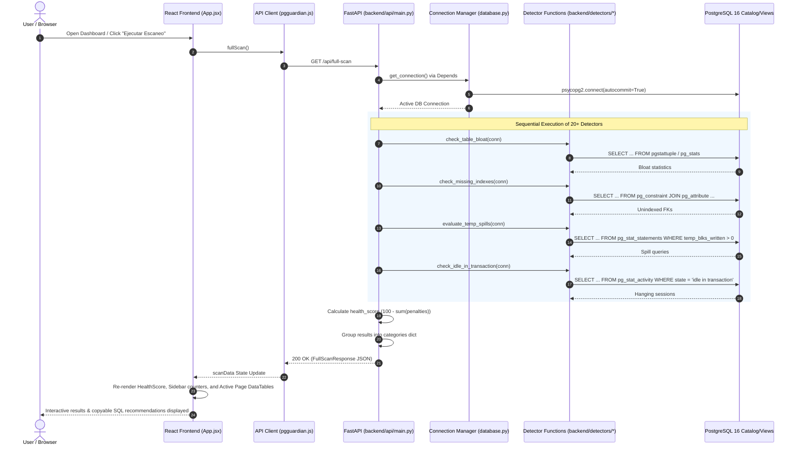

# Project Architecture & Codebase Map: PgGuardian

Document version: 1.0  
Date: November 2026  
Repository: `PgGuardian-Online`  
Author: Technical Audit & Architecture Review (/ponytail-audit)

---

## 1. Executive Summary & Core Purpose

### 1.1 Purpose and Value Proposition
**PgGuardian** is an automated, non-invasive B2B auditing and observability platform for PostgreSQL databases in production. It is designed specifically for small-to-midsize engineering teams (5–50 developers) lacking a dedicated Database Administrator (DBA), particularly within Mexico and Latin America.

Unlike heavyweight APM platforms (such as Datadog or pganalyze), PgGuardian provides:
1. **Targeted, actionable recommendations in Spanish**, complete with copy-pasteable SQL remediation scripts.
2. **Read-only, non-invasive catalog analysis**, minimizing operational overhead.
3. **Self-hosted and cloud-friendly deployment options**, addressing strict financial and data privacy regulations.
4. **Transparent, accessible pricing** ($49 USD/month per instance).

### 1.2 Academic & Evaluation Context
The codebase is structured around the **SIS2404** benchmark database (`tiendadb`), an e-commerce simulation designed to test automated detection engines against **18 intentionally planted performance and configuration defects (H01–H18)** across 5 operational pillars:
- **Indexes:** Missing foreign key indexes, duplicate indexes, unused indexes, missing partial indexes, missing covering indexes, obsolete statistics, and leading wildcard queries.
- **Bloat & Maintenance:** Table bloat, disabled autovacuum, and dead tuple accumulation.
- **Problematic Queries:** Sequential scans on large tables, low `work_mem` spills to disk (sort/hash spills), high execution time queries, and database-level temporary file generation.
- **Server Configuration:** Undersized `shared_buffers`, low `work_mem`, low `pg_stat_statements.max` query tracking limits, and disabled slow query logging (`log_min_duration_statement = -1`).
- **General Health:** Tables requiring partitioning / lacking data retention policies, and persistent idle-in-transaction connection leaks.

### 1.3 Core Technology Stack
| Layer | Technologies | Key Modules & Versions |
|---|---|---|
| **Database Engine** | PostgreSQL 16 | `pg_stat_statements`, `pgstattuple`, `pg_partman`, `pg_trgm` |
| **Backend API** | Python 3.12 | FastAPI `0.115.0`, Uvicorn `0.30.0`, Psycopg2-binary `2.9.9`, Pydantic `2.9.0` |
| **Frontend Dashboard** | React 19 (SPA) | React `19.2.6`, Vite `8.0.12`, React Router DOM `7.15.0` |
| **Marketing Landing** | React 18 (SPA) | React `18.3.1`, Vite `5.4.8`, Tailwind CSS `3.4.13` |
| **Containerization** | Docker & Compose | Multi-stage Dockerfiles, Docker Compose v2 |

---

## 2. Directory Structure & File Map

```text
PgGuardian-Online/
├── .env                                  # Local environment configuration
├── .gitignore                            # Git ignore patterns
├── docker-compose.yml                    # Multi-container orchestration (db, idle_tx, api, frontend)
├── Dockerfile                            # Custom PostgreSQL 16 image compiling pg_partman
├── postgresql.conf                       # Engine configuration with planted bottlenecks (H13-H16)
├── README.md                             # Public repository documentation & product overview
├── README_INSTRUCCIONES.md                 # Evaluation rubric and benchmark specifications
├── scratchpad.md                         # [This File] Master architecture map & technical audit
│
├── backend/
│   ├── Dockerfile.api                    # Container definition for FastAPI backend (Python 3.12-slim)
│   ├── requirements.txt                  # Python runtime dependencies
│   │
│   ├── api/                              # REST API presentation layer
│   │   ├── database.py                   # Psycopg2 connection generator & lifecycle manager
│   │   ├── main.py                       # Application entrypoint, CORS, router mounting, /full-scan
│   │   ├── schemas.py                    # Pydantic response models (DetectorResponse, FullScanResponse)
│   │   └── routers/                      # Category-specific REST endpoints
│   │       ├── __init__.py               # Package marker
│   │       ├── bloat.py                  # Endpoints for table bloat, autovacuum, and dead tuples
│   │       ├── config.py                 # Endpoints for server settings (work_mem, shared_buffers, etc.)
│   │       ├── health.py                 # Endpoints for partitioning and idle transactions
│   │       ├── indexes.py                # Endpoints for index audit (duplicates, unused, FKs, partial)
│   │       └── queries.py                # Endpoints for temp spills, seq scans, and slow queries
│   │
│   ├── detectors/                        # Core analysis & diagnosis engine (Catalog SQL queries)
│   │   ├── bloat.py                      # Bloat calculation (pgstattuple), autovacuum, dead tuples
│   │   ├── config.py                     # Memory/buffer evaluation (pg_settings)
│   │   ├── health.py                     # Partitioning candidates, idle-in-transaction detector
│   │   ├── indexes.py                    # FK index audit, duplicates, unused, partial, covering, wildcards
│   │   └── queries.py                    # Query performance, temp spills, EXPLAIN plan analyzer
│   │
│   └── discovery_queries/                # Reference SQL prototypes & catalog documentation
│       ├── bloat.sql                     # Raw queries for bloat detection
│       ├── config.sql                    # Raw queries for runtime settings
│       ├── health.sql                    # Raw queries for table sizes and transaction states
│       ├── indexes.sql                   # Raw queries for index diagnostics and catalog lookups
│       └── queries.sql                   # Raw queries for pg_stat_statements introspection
│
├── frontend/                             # React 19 SPA Dashboard
│   ├── Dockerfile                        # Node 20-alpine container running Vite dev server
│   ├── package.json                      # Frontend dependencies (React 19, React Router 7)
│   ├── vite.config.js                    # Vite build & server configuration
│   ├── index.html                        # HTML5 entrypoint
│   └── src/
│       ├── main.jsx                      # React DOM root render
│       ├── App.jsx                       # Root view, router configuration, 30s polling cycle
│       ├── App.css                       # Layout, topbar, and utility styles
│       ├── index.css                     # Global design tokens and theme variables
│       │
│       ├── api/
│       │   └── pgguardian.js             # API client functions wrapping fetch calls
│       │
│       ├── components/                   # Reusable UI widgets
│       │   ├── CategoryCard.jsx          # Category summary cards for Overview
│       │   ├── DataTable.jsx             # Generic data table with formatting & SQL copy block
│       │   ├── HealthScore.jsx           # Circular/numeric health score visualization
│       │   ├── SeverityBadge.jsx         # Severity tag (CRITICAL, HIGH, MEDIUM, LOW, OK)
│       │   ├── Sidebar.jsx               # Navigation bar with badge counters
│       │   └── SqlRecommendation.jsx     # Code block for copyable SQL remediation snippets
│       │
│       └── pages/                        # Route pages corresponding to audit categories
│           ├── Overview.jsx              # System health summary, score, and urgent findings
│           ├── BloatPage.jsx             # Table bloat and autovacuum tables
│           ├── ConfigPage.jsx            # Engine configuration evaluations
│           ├── HealthPage.jsx            # Partitioning and connection diagnostics
│           ├── IndexesPage.jsx           # Index recommendations and audit tables
│           └── QueriesPage.jsx           # Problematic queries, spills, and execution plans
│
├── landing/                              # Public marketing site
│   ├── package.json                      # Dependencies (React 18, Tailwind CSS 3)
│   ├── vite.config.js                    # Vite setup
│   └── src/components/LandingPage.jsx    # Complete single-page landing with pricing & features
│
├── init/                                 # PostgreSQL initialization scripts (auto-executed at boot)
│   ├── 01_schema.sql                     # Base e-commerce schema (8 relational tables)
│   ├── 02_seed_data.sql                  # Initial dataset (~100k orders, ~300k order items)
│   └── 03_plant_problems.sql             # Benchmark test suite planting issues H01 through H18
│
└── scripts/
    ├── scale_to_large.sql                # Scales database to ~18M rows / ~2 GB for load testing
    └── start_idle_tx.sh                  # Background daemon creating persistent idle transaction
```

---

## 3. Core Architecture & Components

```
+---------------------------------------------------------------------------------------+
|                                    PRESENTATION LAYER                                 |
|   Frontend (React 19 + Vite)                          Landing (React 18 + Tailwind)   |
|   - App.jsx (Global 30s Polling State)                - LandingPage.jsx               |
|   - Sidebar, DataTable, SqlRecommendation                                             |
|   - Category Pages (Bloat, Config, Health, Indexes, Queries)                          |
+-------------------------------------------+-------------------------------------------+
                                            | HTTP REST (/api/*)
                                            v
+---------------------------------------------------------------------------------------+
|                                  API GATEWAY & ENGINE                                 |
|   FastAPI Application (backend/api/main.py)                                           |
|   - CORS Middleware & Lifespan                                                        |
|   - Dependency Injection: get_connection() (backend/api/database.py)                  |
|   - Category Routers: bloat, config, health, indexes, queries                         |
|   - Aggregation Endpoint: /api/full-scan                                              |
|   - Dynamic Health Score Calculation Engine (0 - 100 with weighted penalties)         |
+-------------------------------------------+-------------------------------------------+
                                            | Internal Python Calls
                                            v
+---------------------------------------------------------------------------------------+
|                                    DETECTION CORE                                     |
|   backend/detectors/                                                                  |
|   ├── bloat.py     (check_table_bloat, check_disabled_autovacuum, check_dead_tuples)   |
|   ├── config.py    (evaluate_work_mem, evaluate_shared_buffers, pg_stat_statements)   |
|   ├── health.py    (check_partitioning_candidates, check_idle_in_transaction)         |
|   ├── indexes.py   (check_missing_indexes, check_duplicates, check_unused, wildcards)  |
|   └── queries.py   (evaluate_temp_spills, detect_seq_scans, evaluate_top_time)        |
+-------------------------------------------+-------------------------------------------+
                                            | SQL Queries (Catalogs & Views)
                                            v
+---------------------------------------------------------------------------------------+
|                                    DATABASE LAYER                                     |
|   PostgreSQL 16 Engine                                                                |
|   - System Views: pg_stat_user_tables, pg_stat_user_indexes, pg_stat_activity         |
|   - System Catalogs: pg_class, pg_index, pg_constraint, pg_settings, pg_stats         |
|   - Extensions: pg_stat_statements, pgstattuple, pg_partman, pg_trgm                  |
+---------------------------------------------------------------------------------------+
```

### 3.1 Database Layer & Target Engine
The system interrogates the internal metadata of PostgreSQL. It relies primarily on:
- **`pg_catalog`**: Structural analysis (`pg_class`, `pg_attribute`, `pg_namespace`, `pg_index`, `pg_constraint`, `pg_settings`).
- **`pg_stat` subsystem**: Dynamic runtime metrics (`pg_stat_user_tables`, `pg_stat_user_indexes`, `pg_stat_database`, `pg_stat_activity`).
- **`pg_stat_statements`**: Query performance counters (`calls`, `total_exec_time`, `temp_blks_written`, `temp_blks_read`).
- **`pgstattuple`**: Physical page tuple density and bloat quantification.
- **`pg_partman`**: Partition maintenance and structure verification.

### 3.2 Detector Engine (`backend/detectors/`)
Each detector is a pure Python function receiving a `psycopg2` connection, issuing a specific SQL query, and returning a list of dictionaries with standardized fields:
- `evidence`: Plain-text justification detailing the exact metric, threshold breached, and affected table/query.
- `sql_recommendation` / `sql_fix`: Ready-to-execute SQL command (e.g., `CREATE INDEX CONCURRENTLY`, `VACUUM FULL`, `ALTER SYSTEM SET`).
- Metadata attributes (`severity`, `table_name`, `calls`, `pct`, etc.).

#### Coverage of Benchmark Problems (H01–H18):
| Benchmark ID | Problem Planted | Detector Module | Primary Detection Function |
|---|---|---|---|
| **H01** | Missing index on `orders.customer_id` (FK) | `backend/detectors/indexes.py` | `check_missing_indexes` |
| **H02** | Duplicate index on `products(category_id)` | `backend/detectors/indexes.py` | `check_duplicate_indexes` |
| **H03** | Unused index on `customers.birth_date` | `backend/detectors/indexes.py` | `check_unused_indexes` |
| **H04** | Missing partial index on `orders(status)` | `backend/detectors/indexes.py` | `check_missing_partial_indexes` |
| **H05** | Missing covering index on report queries | `backend/detectors/indexes.py` | `check_covering_index_candidates` |
| **H06** | Severe table bloat on `event_log` (~40%) | `backend/detectors/bloat.py` | `check_table_bloat` |
| **H07** | Autovacuum disabled on `inventory` | `backend/detectors/bloat.py` | `check_disabled_autovacuum` |
| **H08** | Accumulated dead tuples on `reviews` (~50%)| `backend/detectors/bloat.py` | `check_dead_tuples` |
| **H09** | Seq scan query on `orders` due to missing FK | `backend/detectors/queries.py` | `detect_seq_scan_queries` |
| **H10** | Stale planner statistics on `products` | `backend/detectors/indexes.py` | `check_obsolete_stats` |
| **H11** | Sort spill to disk (`work_mem` too low) | `backend/detectors/queries.py` | `evaluate_temp_spills`, `evaluate_explain_spills` |
| **H12** | Leading wildcard search (`LIKE '%...%'`) | `backend/detectors/indexes.py` | `check_leading_wildcard_searches` |
| **H13** | `shared_buffers` undersized (128MB) | `backend/detectors/config.py` | `evaluate_shared_buffers` |
| **H14** | `work_mem` undersized (4MB) | `backend/detectors/config.py` | `evaluate_work_mem` |
| **H15** | `pg_stat_statements.max` too low (100) | `backend/detectors/config.py` | `evaluate_pg_stat_statements_max`, `check_pg_stat_statements_limit` |
| **H16** | Slow query logging disabled (`log_min_duration_statement = -1`) | `backend/detectors/config.py` | `check_slow_query_logging`, `evaluate_log_min_duration_statement` |
| **H17** | Persistent idle in transaction connection | `backend/detectors/health.py` | `check_idle_in_transaction` |
| **H18** | Unbounded table growth / no retention | `backend/detectors/health.py` | `check_partitioning_candidates` |

### 3.3 Scoring & Heuristic Penalty Engine (`backend/api/main.py`)
The health score is computed dynamically in `/api/full-scan` by starting at 100 points and applying weighted deductions based on findings:
```python
penalty = 0
# Bloat penalties
penalty += len(bloat_warnings) * 5
penalty += len(disabled_autovacuum) * 10
penalty += len(dead_warnings) * 5

# Config penalties
penalty += len(work_mem_eval) * 8
penalty += len(shared_buffers_eval) * 8
penalty += len(pg_stat_max_eval) * 5
penalty += len(pg_stat_limit) * 3
penalty += len(slow_query_logging) * 5

# Health penalties
penalty += len(partition_candidates) * 2
penalty += len(idle_in_transaction) * 10

# Indexes penalties
penalty += len(missing_indexes) * 6
penalty += len(duplicate_indexes) * 4
penalty += len(unused_indexes) * 3
penalty += len(missing_partial) * 3
penalty += len(obsolete_stats) * 5
penalty += len(wildcard_searches) * 3
penalty += len(covering_candidates) * 2

# Queries penalties
penalty += len([s for s in temp_spills if s.get("severity") == "HIGH"]) * 8
penalty += len([s for s in temp_spills if s.get("severity") == "MEDIUM"]) * 5
penalty += len(seq_scans) * 4
penalty += len(top_time_queries) * 4
penalty += len(db_temp_usage) * 5
penalty += len(explain_spills) * 6

health_score = max(0, 100 - penalty)
```

---

## 4. End-to-End Data & Execution Flow

### 4.1 Initialization & Bootstrapping Sequence
1. **Container Launch (`docker compose up -d`):**
   - Service `db` initializes:
     - Installs `pg_partman` via `Dockerfile`.
     - Mounts `postgresql.conf` with misconfigurations into `/etc/postgresql/postgresql.conf`.
     - Executes entrypoint scripts in `/docker-entrypoint-initdb.d` in alphabetical order:
       1. `01_schema.sql`: Tables and relations created; enables `pg_stat_statements`.
       2. `02_seed_data.sql`: Generates synthetic data.
       3. `03_plant_problems.sql`: Updates, deletes, and queries to register stats and create bloat.
     - Performs health check: `pg_isready -U tienda_user -d tiendadb`.
   - Service `idle_tx` waits for `db` to become healthy, then runs `start_idle_tx.sh`, opening a transaction and holding an indefinite sleep lock.
   - Service `api` waits for `db` healthcheck, boots FastAPI via `uvicorn api.main:app`.
   - Service `frontend` boots Vite dev server on port `5173`.

### 4.2 Full Diagnostic Scan Flow (`/api/full-scan`)


### 4.3 Automated Polling Loop
- `frontend/src/App.jsx` registers an interval with `POLL_INTERVAL = 30000` (30 seconds).
- Every 30 seconds, if `autoRefresh` is true, `runScan()` is re-invoked, maintaining fresh telemetry without requiring full page reloads.

---

## 5. Configuration & Environment

### 5.1 Environment Variables
Configured in `.env` at repository root and injected into container services:
| Variable | Default Value (Local) | Docker Service Consumer | Description |
|---|---|---|---|
| `DB_NAME` | `tiendadb` | `db`, `api` | Name of the target database |
| `DB_USER` | `tienda_user` | `db`, `api` | Database connection role |
| `DB_PASSWORD` | `tienda_pass` | `db`, `api` | Role authentication secret |
| `DB_PORT` | `5433` (external) / `5432` | `db`, `api` | Port mapped to host |
| `DB_HOST` | `db` (internal Docker network) | `api` | Database host hostname |
| `VITE_API_URL`| `http://localhost:8000/api` | `frontend` | Base endpoint URL for the frontend |

### 5.2 Network Topology & Port Bindings
- `frontend`: Exposes `5173:5173` (Vite dev server).
- `api`: Exposes `8000:8000` (Uvicorn / FastAPI). Swagger UI available at `http://localhost:8000/docs`.
- `db`: Exposes host port `5433` mapped to internal `5432` to avoid conflicts with local PostgreSQL instances.
- `idle_tx`: No exposed ports; connects over internal Docker bridge network to `db:5432`.

### 5.3 Local Development Setup
```bash
# 1. Clone repository
git clone https://github.com/luiselodeon/PgGuardian.git
cd PgGuardian

# 2. Verify or create .env file
cat <<EOF > .env
DB_NAME=tiendadb
DB_USER=tienda_user
DB_PASSWORD=tienda_pass
DB_PORT=5433
EOF

# 3. Build and launch all services
docker compose up -d

# 4. Monitor initial seeding progress (takes ~1-2 min)
docker compose logs -f db
# Wait until: "TiendaDB v1.0 ready with 18 planted problems"

# 5. Access application
# Frontend Dashboard: http://localhost:5173
# API Swagger Docs:   http://localhost:8000/docs
```

---

## 6. Key Patterns, Constraints & Technical Debt

### 6.1 Architectural Patterns
1. **Catalog Introspection Pattern:** All health data is extracted directly from PostgreSQL system catalogs and statistic views, avoiding heavy runtime tracing agents.
2. **Defensive Safe-Runner Pattern:** `_safe_run` wraps detector invocations in `backend/api/main.py`, converting runtime exceptions into error payloads rather than aborting the entire scan.
3. **Normalized Prescription Pattern:** Findings are paired with deterministic SQL remediation scripts (`sql_recommendation`, `sql_fix`), enabling immediate remediation.
4. **Virtual Column Rendering in Frontend:** `DataTable.jsx` dynamically binds `sql_combined` across varied detector key formats (`sql_recommendation`, `sql_fix`, `suggested_action`), ensuring consistent UI presentation.

---

### 6.2 Ranked Technical Audit Findings (Ponytail Audit)

Assumed expected load: **1 to 5 concurrent administrators running diagnostic scans against production PostgreSQL instances hosting 10 to 1,000 queries per second**.

#### Group A: MUST FIX (Bugs, Security Risks, Data Integrity)

1. **Broken partition detection logic flags 100% of tables** (`backend/detectors/health.py:L50-66`)
   - **What this is:** `check_partitioning_candidates` queries `pg_stat_user_tables` to find large or unpartitioned tables lacking retention policies.
   - **Problem:** The `WHERE` clause combines criteria using `OR` instead of `AND`: `WHERE c.relkind = 'r' OR c.relispartition = false OR ...`. Because every normal table in PostgreSQL satisfies `c.relkind = 'r'`, this query returns every single table in the database (including 50-row lookup tables like `categories`) as a candidate for partitioning.
   - **Fix:** Require tables to be standard tables (`c.relkind = 'r' AND c.relispartition = false`) AND meet at least one threshold (size > 500MB OR inserts > 100k):
     ```sql
     WHERE c.relkind = 'r' 
       AND NOT c.relispartition
       AND (pg_total_relation_size(stat.relid) > 500 * 1024 * 1024 OR stat.n_tup_ins > 100000)
     ```
   - **If we skip it:** Every scan produces massive false positives, violating the rubric penalty (-0.5 pts per false positive) and recommending complex table partitioning where completely inappropriate.

2. **Hardcoded database username disables idle transaction detector** (`backend/detectors/health.py:L158`)
   - **What this is:** `check_idle_in_transaction` checks `pg_stat_activity` for connections lingering in transaction.
   - **Problem:** The query has a hardcoded filter: `AND usename = 'tienda_user';`. When deployed against any database with a different user, the detector returns zero findings regardless of how many hanging transactions exist.
   - **Fix:** Remove the hardcoded username filter and exclude only background/system processes: `AND usename NOT IN ('postgres') AND backend_type = 'client backend'`.
   - **If we skip it:** The detector completely fails on real client databases or the professor's Demo Day v2 benchmark.

3. **Destructive DDL and privilege escalation in "read-only" tool** (`backend/detectors/bloat.py:L29`, `backend/detectors/health.py:L31-33`)
   - **What this is:** PgGuardian advertises itself as a non-invasive, strictly read-only auditor.
   - **Problem:** `check_table_bloat` executes `CREATE EXTENSION IF NOT EXISTS pgstattuple;` and `check_partitioning_candidates` executes `CREATE SCHEMA IF NOT EXISTS partman; CREATE EXTENSION IF NOT EXISTS pg_partman SCHEMA partman;`. In a true read-only connection with standard credentials, these queries immediately throw permission denied errors because extension creation requires superuser privileges.
   - **Fix:** Query `pg_extension` first; if the extension is absent, return a descriptive warning finding instructing the DBA to install it, or fall back to catalog-only estimations.
   - **If we skip it:** The application crashes or fails in any production environment adhering to the principle of least privilege.

4. **Dynamic SQL injection and query execution in `evaluate_single_explain`** (`backend/detectors/queries.py:L354-367`)
   - **What this is:** Validates whether slow queries from `pg_stat_statements` suffer sort/hash disk spills by generating an execution plan.
   - **Problem:** It substitutes `$1` with `NULL` and formats the string directly into `EXPLAIN (ANALYZE, BUFFERS) {sanitized_query}`. `EXPLAIN ANALYZE` actually executes the query on the database. If a user query invokes a function with side effects (e.g. data modification or long sleep), running it during audit triggers side effects and places locks on tables.
   - **Fix:** Use standard `EXPLAIN` without `ANALYZE` (read-only plan estimation) or restrict plan analysis to verified read-only statements using parameterized statements.
   - **If we skip it:** Audit scans can execute destructive user functions or cause production latency spikes.

5. **`EXPLAIN (GENERIC_PLAN)` crash on non-parameterized queries** (`backend/detectors/queries.py:L458-498`)
   - **What this is:** `detect_seq_scan_queries` uses Postgres 16's `GENERIC_PLAN` option to inspect top query plans.
   - **Problem:** In PostgreSQL, `EXPLAIN (GENERIC_PLAN)` throws an error if executed on a query that has no parameter placeholders (`$1`). The exception is caught by a blanket `try/except` which performs a `conn.rollback()`, silently skipping analysis for all static queries in the top 20 list.
   - **Fix:** Check whether the query string contains `$1` before passing `(GENERIC_PLAN)`; otherwise, pass a standard `EXPLAIN` without parameters.
   - **If we skip it:** Static queries with severe sequential scans are never inspected.

---

#### Group B: SHOULD FIX (Performance, Redundancy, Scale)

6. **Sequential blocking execution in `/api/full-scan`** (`backend/api/main.py:L129-173`)
   - **What this is:** `/api/full-scan` executes over 20 detector functions sequentially on a single database connection.
   - **Problem:** If individual queries take 1–2 seconds (or if `EXPLAIN ANALYZE` waits on locks), the cumulative execution time exceeds 20–30 seconds, blocking the request thread and causing frontend timeouts.
   - **Fix:** Concurrently execute independent detector queries using Python `asyncio` or a thread pool with dedicated connections.
   - **If we skip it:** The dashboard feels sluggish and full scans frequently time out under production loads.

7. **No database connection pooling** (`backend/api/database.py:L12-36`)
   - **What this is:** Database connection manager for FastAPI.
   - **Problem:** `get_connection()` creates a brand-new TCP socket connection via `psycopg2.connect()` and closes it on every single request.
   - **Fix:** Use `psycopg2.pool.ThreadedConnectionPool` or `asyncpg` to maintain a persistent connection pool of 5–10 reusable connections.
   - **If we skip it:** High latency per request and PostgreSQL connection exhaustion when multiple dashboard users are active.

8. **Duplicate detector execution and double score penalty for H15** (`backend/api/main.py:L149-150`, `L342-343`)
   - **What this is:** Detection of low `pg_stat_statements.max` setting.
   - **Problem:** Both `evaluate_pg_stat_statements_max` and `check_pg_stat_statements_limit` in `backend/detectors/config.py` check the identical condition (`s.setting < 1000`). Both are called in `full_scan`, returning duplicate findings and penalizing the health score twice (-5 and -3 = -8 points).
   - **Fix:** Remove one of the duplicate functions and consolidate into `check_pg_stat_statements_limit`.
   - **If we skip it:** Distorts the health score calculation and displays duplicated cards on the configuration page.

9. **Identical `_serialize` helper copy-pasted in 6 files** (`backend/api/main.py`, `backend/api/routers/*.py`)
   - **What this is:** Helper function to convert `psycopg2.extras.RealDictRow` and `Decimal` values into standard JSON-serializable dictionaries.
   - **Problem:** Exactly 12 lines of serialization code are copy-pasted across `main.py`, `bloat.py`, `config.py`, `health.py`, `indexes.py`, and `queries.py`.
   - **Fix:** Move `_serialize` into a shared utility file (e.g. `backend/api/utils.py` or `backend/api/schemas.py`) and import it.
   - **If we skip it:** Any serialization bugfix or optimization must be manually replicated across 6 separate files.

10. **Zero automated test coverage** (Workspace root)
    - **What this is:** Test harness for backend detector SQL and API endpoints.
    - **Problem:** The repository has zero test files (`pytest`, `unittest`, or frontend tests). A small SQL syntax error in any detector will crash the `/full-scan` endpoint without warning until manually verified.
    - **Fix:** Add a minimal `pytest` suite with mock catalog fixtures or a Dockerized test runner validating that all detector functions return valid schemas.
    - **If we skip it:** High regression risk whenever queries or threshold algorithms are adjusted.

---

#### Group C: NICE TO HAVE (Lean Code, Cleanup)

11. **Dead/unused individual REST endpoints in frontend client** (`frontend/src/api/pgguardian.js:L29-62`)
    - **What this is:** 22 individual API endpoint wrappers defined in the frontend client.
    - **Problem:** The React dashboard exclusively uses `fullScan()`. The remaining 22 functions and their backend router counterparts are completely unreferenced in the UI.
    - **Fix:** Keep the consolidated `/full-scan` endpoint as the primary interface, or document the individual endpoints as public developer API.
    - **If we skip it:** Extra endpoints to maintain without clear UI consumers.

12. **React version divergence between dashboard and landing** (`frontend/package.json`, `landing/package.json`)
    - **What this is:** Package dependencies for the two frontend workspaces.
    - **Problem:** `frontend` runs React 19 (`^19.2.6`), while `landing` runs React 18 (`^18.3.1`).
    - **Fix:** Unify both applications on a single React version or consolidate into a monorepo workspace.
    - **If we skip it:** Slight maintenance overhead across two separate node environments.

13. **Hardcoded credentials in `start_idle_tx.sh`** (`scripts/start_idle_tx.sh:L11`)
    - **What this is:** Helper script simulating an abandoned transaction container.
    - **Problem:** Hardcodes `PGPASSWORD=tienda_pass` and user `tienda_user` rather than reading environment variables.
    - **Fix:** Use `${DB_PASSWORD}` and `${DB_USER}` with defaults.
    - **If we skip it:** Fails if credentials in `.env` are customized.

---

## 7. Audit Summary & Verdict

- **Verdict:** Functional proof-of-concept with high domain accuracy against PostgreSQL catalogs, but currently hindered by critical logic bugs (such as 100% false positives on partitioning candidates), non-read-only DDL execution, and lack of connection pooling.
- **Lean Potential:** ~180 lines of duplicated code (repetitive `_serialize` declarations and duplicate config detectors) and 1 unused dependency can be eliminated immediately.
- **Verification Note:** All 18 benchmark issues (H01–H18) have corresponding detection logic mapped, but generic resilience requires removing hardcoded filters (`usename = 'tienda_user'`) prior to testing against unexpected database environments.

---

## RF-01.1 y RF-01.2 - Registro de Cambios y Decisiones Técnicas

### 1. Archivos Creados y Modificados

#### Backend (FastAPI)
- **`backend/requirements.txt`** *(modificado)*: Se agregó `python-multipart==0.0.20`, requerido por FastAPI/Starlette para procesar peticiones `multipart/form-data` con `UploadFile` y `Form`.
- **`backend/api/schemas.py`** *(modificado)*: Se añadieron los modelos Pydantic `AnalysisFileSummary` y `AnalysisCreateResponse` para tipar la respuesta de `POST /api/analyses`.
- **`backend/api/routers/analyses.py`** *(creado)*: Nuevo router con prefijo `/api/analyses` y endpoint `POST /api/analyses`, incluyendo las funciones de validación `_parse_execution_order` y `_read_and_validate_file`.
- **`backend/api/main.py`** *(modificado)*: Se importó y montó `analyses_router.router` dentro de la aplicación FastAPI sin alterar los detectores ni endpoints existentes de TiendaDB.
- **`backend/tests/test_analyses.py`** *(creado)*: Suite de pruebas unitarias con `unittest` (`IsolatedAsyncioTestCase`) que verifica carga válida, reordenamiento, rechazo por cantidad, extensión inválida, UTF-8 inválido, límites de peso (10 MB / 25 MB) y parámetro `order` malformado.

#### Frontend (React 19 + Vite)
- **`frontend/src/api/pgguardian.js`** *(modificado)*: Se agregó la función `createAnalysis(files, order)` que envía `FormData` vía `POST ${API_BASE}/analyses` y propaga el campo `detail` de errores HTTP en español.
- **`frontend/src/components/NewAnalysisModal.jsx`** *(creado)*: Modal accesible con selector múltiple y drag-and-drop para archivos `.sql`, validación en cliente, lista reordenable (botones `Subir`/`Bajar` y arrastre de filas) y vista de resumen tras recibir `201 Created`.
- **`frontend/src/components/NewAnalysisModal.css`** *(creado)*: Estilos del modal, dropzone, cola ordenada y tabla de resultados usando las variables de diseño existentes en `frontend/src/index.css`.
- **`frontend/src/App.jsx`** *(modificado)*: Se incorporó el botón **«Nuevo análisis»** en la barra superior (`.top-bar-actions`) y el montaje condicional de `NewAnalysisModal`.
- **`frontend/src/App.css`** *(modificado)*: Se agregó la clase `.new-analysis-button` alineada con la paleta y jerarquía visual de `.scan-button`.

### 2. Decisiones Técnicas y Alineación Arquitectónica
- **Desacoplamiento de `app_db` y `sandbox_db` (alcance RF-01.1 / RF-01.2):** Dado que la creación de tablas en `app_db` (RF-02) y la ejecución aislada en `sandbox_db` (RF-01.4) pertenecen a incrementos separados, `POST /api/analyses` valida los scripts en memoria y retorna `201 Created` con un identificador UUID temporal, estado `"validado"` y el resumen ordenado de los archivos, manteniendo intacta la compatibilidad con TiendaDB (RNF-05) y sin introducir dependencias de base de datos ni `pglast` (RF-01.3).
- **Lectura por bloques (*streaming*) en FastAPI:** `_read_and_validate_file` lee cada `UploadFile` en fragmentos de 1 MB (`READ_CHUNK_BYTES`) acumulando el tamaño individual y total en curso. Esto evita cargar en memoria archivos sobredimensionados antes de rechazarlos con `413` y asegura el cierre de descriptores en un bloque `finally`.
- **Preservación explícita del orden secuencial:** El endpoint recibe el parámetro opcional `order` como `Form` (arreglo JSON de índices base 0, o enteros separados por coma) además del orden del arreglo `files`. El frontend envía los archivos ya reordenados junto con `order = [0, 1, ...]` y el backend reasigna posiciones consecutivas `1..N` en la respuesta.
- **Validación dual Cliente + Servidor en React:** El modal valida extensión `.sql`, límite de 5 archivos, ≤ 10 MB individuales y ≤ 25 MB acumulados antes de enviar; la validación estricta de codificación UTF-8 se ejecuta en el backend (además de revalidar tamaño, cantidad, extensión y orden en el límite de confianza), permitiendo feedback inmediato en UI sin ocultar rechazos `422` por codificación inválida.
- **Sin dependencias externas nuevas en Frontend:** El reordenamiento usa estado nativo de React con controles de teclado/clic (`↑` / `↓`) y eventos HTML5 Drag-and-Drop, evitando librerías externas innecesarias.

### 3. Reglas de Validación Aplicadas
1. **Cantidad de archivos:** Mínimo `1` (`MIN_FILES = 1`) y máximo `5` (`MAX_FILES = 5`) por análisis.
2. **Extensión:** Solo archivos con sufijo `.sql` (insensible a mayúsculas, verificando nombre base no vacío mediante `PurePosixPath(filename).suffix.lower() == ".sql"` en backend y comprobación equivalente en cliente).
3. **Tamaño de archivo e impacto acumulado:**
   - Individual: máximo `10 * 1024 * 1024` bytes (10 MB) por archivo (`MAX_FILE_SIZE_BYTES`).
   - Combinado: máximo `25 * 1024 * 1024` bytes (25 MB) sumando todos los archivos de la petición (`MAX_TOTAL_SIZE_BYTES`).
4. **Codificación UTF-8 estricta:** Decodificación estricta `raw_bytes.decode("utf-8")` sin reemplazo ni tolerancia de bytes inválidos.
5. **Orden de ejecución:** El parámetro opcional `order` debe representar una permutación exacta y sin duplicados ni booleanos de `0 .. len(files) - 1`.

### 4. Manejo de Errores y Códigos HTTP
Todos los mensajes de error se devuelven en español bajo el campo estándar `detail` de FastAPI (cumpliendo RNF-04):
- **`201 Created`:** Todos los archivos cumplen las reglas; devuelve `AnalysisCreateResponse` con `id`, `status: "validado"`, `message`, `file_count`, `total_size_bytes`, `files` (ordenados `1..N` con nombre, tamaño en bytes, codificación `"utf-8"` y conteo de líneas) y `created_at`.
- **`400 Bad Request`:** Menos de 1 archivo o archivo sin nombre válido, más de 5 archivos, o parámetro `order` malformado, con longitud incompatible o índices inválidos/duplicados.
- **`413 Content Too Large`:** Cualquier archivo supera 10 MB o el peso acumulado supera 25 MB.
- **`422 Unprocessable Entity`:** Extensión distinta de `.sql` o contenido con bytes no decodificables en UTF-8 estricto.

---

## RF-01.3 y RF-01.4 - Registro de Implementación, Seguridad y Sandbox

### 1. Archivos Creados y Modificados
- **`.env`** *(modificado)*: Se añadieron las variables dedicadas para el servidor sandbox (`SANDBOX_DB_NAME`, `SANDBOX_DB_ADMIN_USER`, `SANDBOX_DB_ADMIN_PASSWORD`, `SANDBOX_DB_EXEC_USER`, `SANDBOX_DB_EXEC_PASSWORD`), desacopladas de `DB_*` (TiendaDB / `app_db`).
- **`docker-compose.yml`** *(modificado)*: Se incorporó el servicio aislado `sandbox_db` (`postgres:16`, contenedor `pgguardian_sandboxdb`, volumen `sandbox_data`, sin puertos públicos expuestos ni scripts de `init/`), y se inyectaron las variables `SANDBOX_DB_*` y la dependencia `depends_on: sandbox_db (service_healthy)` en el servicio `api`.
- **`backend/requirements.txt`** *(modificado)*: Se agregó `pglast==6.17` (parser nativo de PostgreSQL 16 vía `libpg_query`).
- **`backend/services/__init__.py`** *(creado)*: Marcador de paquete para la capa de servicios del backend.
- **`backend/services/sql_validator.py`** *(creado)*: Servicio de análisis estático AST con `pglast` (`validate_sql_script`, `validate_scripts`, `_SafetyVisitor`, `SqlValidationError`, `ParsedStatement`).
- **`backend/services/sandbox_runner.py`** *(creado)*: Servicio de aprovisionamiento y ejecución aislada en `sandbox_db` (`execute_in_sandbox`, `_provision_sandbox_db`, `_ensure_unprivileged_role`, `_drop_sandbox_db`, `SandboxExecutionError`, `SandboxResult`).
- **`backend/api/schemas.py`** *(modificado)*: Se extendió `AnalysisCreateResponse` con `sandbox_db_name`, `executed_statements` y `execution_time_ms`.
- **`backend/api/routers/analyses.py`** *(modificado)*: Se integró la secuencia RF-01.1/01.2 → RF-01.3 (`validate_scripts`) → RF-01.4 (`run_in_threadpool(execute_in_sandbox, ...)`) antes de devolver `201 Created` (`status: "ejecutado"`).
- **`frontend/src/api/pgguardian.js`** y **`frontend/src/components/NewAnalysisModal.jsx`** *(modificados)*: Soporte para formatear errores estructurados (`detail` con archivo y línea) y mostrar `sandbox_db_name`, `executed_statements` y `execution_time_ms` tras la ejecución.
- **`backend/tests/test_sql_validator.py`** y **`backend/tests/test_sandbox_runner.py`** *(creados)* + **`backend/tests/test_analyses.py`** *(actualizado)*: Cobertura unitaria para reglas AST, aislamiento de configuración, fail-fast, limpieza y timeout de 120 s.

### 2. Nodos de `pglast` Inspeccionados y Reglas AST (RF-01.3)
El validador utiliza `pglast.parse_sql`, `pglast.parser.scan` (cálculo exacto de línea y fragmento omitiendo comentarios iniciales sin usar expresiones regulares) y `pglast.visitors.Visitor` sobre cada `RawStmt`:

| Regla (`rule`) | Nodos AST de `pglast` inspeccionados | Condición de rechazo |
|---|---|---|
| `alter_system` | `AlterSystemStmt` | Rechazo incondicional (`ALTER SYSTEM SET/RESET`). |
| `copy_program` / `copy_file` | `CopyStmt` | Rechazo cuando `is_program == True` o `filename is not None` (permite `COPY ... FROM STDIN`). |
| `role_management` | `CreateRoleStmt`, `AlterRoleStmt`, `AlterRoleSetStmt`, `DropRoleStmt`, `GrantRoleStmt`, `VariableSetStmt` | Rechazo de creación/alteración/eliminación/asignación de roles y `SET ROLE` / `SET SESSION AUTHORIZATION`. |
| `critical_privilege` | `GrantStmt`, `AlterOwnerStmt` | Rechazo sobre `OBJECT_DATABASE`, `OBJECT_TABLESPACE`, `OBJECT_FDW`, `OBJECT_FOREIGN_SERVER`, `OBJECT_PARAMETER_ACL` o esquemas del sistema (`pg_*`, `information_schema`). |
| `database_management` | `CreatedbStmt`, `DropdbStmt`, `AlterDatabaseStmt`, `AlterDatabaseSetStmt`, `AlterDatabaseRefreshCollStmt`, `AlterOwnerStmt`, `RenameStmt` | Rechazo de cualquier creación, eliminación, cambio de dueño, renombrado o `ALTER DATABASE`. |
| `system_object_management` | `CreateTableSpaceStmt`, `DropTableSpaceStmt`, `CreateFdwStmt`, `AlterFdwStmt`, `CreateForeignServerStmt`, `AlterForeignServerStmt`, `CreateUserMappingStmt`, `DropStmt` | Rechazo de tablespaces, wrappers/servidores externos y `DROP` sobre lenguajes/FDW/servidores. |
| `disallowed_extension` | `CreateExtensionStmt`, `AlterExtensionStmt`, `AlterExtensionContentsStmt` | Bloqueo salvo que `extname` pertenezca a `ALLOWED_EXTENSIONS` (`uuid-ossp`, `pgcrypto`, `pg_trgm`, `citext`, `hstore`, `unaccent`, `btree_gin`, `btree_gist`). |
| `untrusted_language` | `CreatePLangStmt`, `CreateFunctionStmt`, `DoStmt` | Rechazo de `CREATE LANGUAGE` y de funciones/bloques `DO` cuyo parámetro `language` no pertenezca a `ALLOWED_FUNCTION_LANGUAGES` (`sql`, `plpgsql`). |

### 3. Aislamiento, Privilegios del Rol y Timeout de 120 s (RF-01.4)
- **Desacoplamiento total:** `_get_sandbox_config()` lee exclusivamente `SANDBOX_DB_*` y nunca invoca `api.database.get_connection()` ni usa variables `DB_*`.
- **Aprovisionamiento por análisis:** Se genera una base única `sandbox_<uuid_hex>` mediante la conexión administrativa (`SANDBOX_DB_ADMIN_USER`), se revoca el acceso `PUBLIC` sobre la base (`REVOKE ALL ON DATABASE ... FROM PUBLIC`) y, dado el endurecimiento de PostgreSQL 15/16 sobre el esquema `public`, se transfiere la propiedad del esquema `public` de esa base efímera al rol ejecutor.
- **Control de privilegios:** `_ensure_unprivileged_role()` crea o reasegura `SANDBOX_DB_EXEC_USER` con `LOGIN NOSUPERUSER NOCREATEDB NOCREATEROLE NOINHERIT NOREPLICATION`. La ejecución de scripts se realiza exclusivamente con una conexión independiente bajo ese rol hacia `sandbox_<uuid_hex>`.
- **Timeout global de 120 s y fail-fast:** `execute_in_sandbox` mantiene un reloj monotónico (`deadline = start + 120s`) y ejecuta cada sentencia validada en orden calculando `remaining_ms = int((deadline - time.monotonic()) * 1000)` y aplicando `SET statement_timeout = %s` antes de cada sentencia (impidiendo evasiones mediante `SET statement_timeout = 0` en un script). Al primer error SQL o vencimiento del límite (`57014`), aborta de inmediato, cierra la conexión ejecutora y ejecuta `DROP DATABASE IF EXISTS <sandbox> WITH (FORCE)` para evitar bases huérfanas.

### 4. Formato de Error Estructurado
Ante fallos de sintaxis o AST (`422`), errores SQL en sandbox (`422`), timeout de 120 s (`408`) o indisponibilidad de `sandbox_db` (`503`), FastAPI devuelve el campo `detail` estructurado en español:
```json
{
  "code": "SQL_AST_BLOCKED | SQL_SYNTAX_ERROR | SANDBOX_EXECUTION_ERROR | SANDBOX_TIMEOUT | SANDBOX_CONNECTION_ERROR",
  "message": "Descripción contextualizada en español",
  "filename": "archivo.sql",
  "line": 12,
  "rule": "alter_system",
  "statement": "ALTER SYSTEM SET work_mem = '64MB'",
  "pgcode": "42P01",
  "pg_error": "Mensaje original de PostgreSQL (cuando aplica en ejecución)"
}
```

---

## RF-01.5 y RF-01.6 - Desacoplamiento de Conexión y Detectores N/A

### 1. Archivos Creados y Modificados
- **`backend/services/scan_service.py`** *(creado)*: Nuevo orquestador desacoplado [`run_full_scan(conn, is_sandbox: bool = False)`] junto con `_safe_run`, `_serialize`, `_not_applicable_detector` y la lógica de normalización del puntaje.
- **`backend/services/sandbox_runner.py`** *(modificado)*: Se añadió `connect_sandbox_db(sandbox_db_name)` para abrir conexiones con el rol sin privilegios (`SANDBOX_DB_EXEC_USER`) directamente sobre la base temporal del análisis.
- **`backend/detectors/bloat.py`** *(modificado)*: En `check_table_bloat(conn)`, la creación de la extensión `pgstattuple` ahora verifica previamente `pg_extension` y captura `psycopg2.Error` (usando `SAVEPOINT` si `autocommit=False`), evitando fallos bajo el rol `NOSUPERUSER` de `sandbox_db` sin alterar su ejecución en TiendaDB.
- **`backend/detectors/health.py`** *(modificado)*: En `check_partitioning_candidates(conn)`, la instalación de `pg_partman` se protege verificando `pg_extension` y capturando `psycopg2.Error`, permitiendo ejecutar el diagnóstico estructural sobre `sandbox_db` sin requerir `pg_partman` ni superusuario.
- **`backend/api/main.py`** *(modificado)*: Se eliminó la lógica duplicada del escaneo y `GET /api/full-scan` ahora delega a `run_full_scan(conn, is_sandbox=False)` inyectando `Depends(get_connection)` para preservar compatibilidad completa con TiendaDB (RNF-05).
- **`backend/api/schemas.py`** *(modificado)*: Se añadieron los campos retrocompatibles `is_sandbox: bool = False`, `evaluated_detectors: int = 22` y `not_applicable_detectors: int = 0` a `FullScanResponse`, y el campo `scan: FullScanResponse` a `AnalysisCreateResponse`.
- **`backend/api/routers/analyses.py`** *(modificado)*: Tras ejecutar los scripts en `sandbox_db`, invoca `_scan_sandbox(sandbox_res.sandbox_db_name)` mediante `connect_sandbox_db(...)` y `run_full_scan(sandbox_conn, is_sandbox=True)` (nunca usa `get_connection()`), devolviendo el reporte en `scan` (`status: "completado"`).
- **`frontend/src/components/SeverityBadge.jsx` / `.css`**, **`CategoryCard.jsx` / `.css`** y **`NewAnalysisModal.jsx`** *(modificados)*: Soporte visual para severidad/estado `NO_APLICA` (`N/A` / `No aplica`) y visualización del `Health Score`, hallazgos y detectores activos vs. N/A en el resumen del modal.
- **`backend/tests/test_scan_service.py`** *(creado)* y **`backend/tests/test_analyses.py`** *(actualizado)*: Pruebas unitarias de inyección de conexión sandbox, omisión de detectores N/A, normalización del score y no-regresión en modo producción.

### 2. Firma y Estructura de `run_full_scan(conn, is_sandbox: bool = False)`
- **Firma:** `run_full_scan(conn, is_sandbox: bool = False) -> FullScanResponse` en `backend/services/scan_service.py`.
- **Inyección de conexión:** Todos los detectores reciben `conn` como primer argumento obligatorio (`check_*(conn)` / `evaluate_*(conn)`). En `GET /api/full-scan` se pasa la conexión de `get_connection()` con `is_sandbox=False`; en `POST /api/analyses` se pasa la conexión efímera de `connect_sandbox_db(sandbox_db_name)` con `is_sandbox=True`.
- **Estructura retrocompatible del reporte:** Cada detector dentro de `categories[cat]["detectors"][key]` mantiene `label`, `count` y `data`, añadiendo `status` (`"ok"` | `"warning"` | `"no_aplica"`). Cuando es `"no_aplica"`, incluye `status_label: "No aplica"`, `reason` en español, `count: 0` (para no inflar contadores en UI) y una entrada descriptiva en `data` con `severity: "NO_APLICA"`.

### 3. Detectores Catalogados como «no aplica» en `is_sandbox=True`
Se excluyen de ejecución y penalización los 9 detectores en `SANDBOX_NOT_APPLICABLE_DETECTORS` por depender de tráfico en vivo o estadísticas acumuladas en `pg_stat_*`:
1. `health.idle_in_transaction` (`pg_stat_activity`: sesiones activas / *idle in transaction*).
2. `indexes.unused_indexes` (`pg_stat_user_indexes`: `idx_scan = 0` sin tráfico previo).
3. `indexes.covering_candidates` (`pg_stat_statements`: consultas frecuentes candidatas a `INCLUDE`).
4. `indexes.wildcard_searches` (`pg_stat_statements`: consultas ejecutadas con `LIKE '%...%'`).
5. `queries.temp_spills` (`pg_stat_statements`: bloques temporales escritos por consulta).
6. `queries.seq_scans` (`pg_stat_statements` + `EXPLAIN`: consultas top con *Seq Scan*).
7. `queries.top_time_queries` (`pg_stat_statements`: consultas con mayor tiempo acumulado).
8. `queries.db_temp_usage` (`pg_stat_database`: archivos temporales acumulados en BD).
9. `queries.explain_spills` (`pg_stat_statements` + `EXPLAIN ANALYZE`: *sort/hash spills*).

Justificación reportada en español: `"No aplica en bases sandbox recién creadas porque no cuentan con estadísticas acumuladas ni métricas de tráfico en vivo."`

### 4. Fórmula Ajustada del Health Score (0–100)
Cada uno de los 22 detectores ponderados posee su peso nominal en `_DETECTOR_WEIGHTS` (suma total `total_weight = 114`):
- **Penalización activa (`active_penalty`):** Suma de `hallazgos * peso` exclusivamente sobre los detectores ejecutados (`key not in excluded`). Los 9 detectores `no_aplica` aportan `0` hallazgos y se omiten de `active_weight`.
- **Normalización sobre detectores válidos (`active_weight`):**
  $$\text{normalized\_penalty} = \text{round}\left(\text{active\_penalty} \times \frac{\text{total\_weight}}{\text{active\_weight}}\right)$$
  $$\text{health\_score} = \max\big(0,\; \min(100,\; 100 - \text{normalized\_penalty})\big)$$
- En modo sandbox (`is_sandbox=True`), `active_weight = 69` (13 detectores activos, 9 `no_aplica`). En modo TiendaDB (`is_sandbox=False`), `excluded` está vacío (`active_weight == total_weight == 114`), por lo que el factor de escala es `1.0` y el cálculo coincide exactamente con la fórmula original.

### 5. Verificación de No-Regresión (TiendaDB)
- `GET /api/full-scan` sigue operando con `Depends(get_connection)` (`is_sandbox=False`), ejecutando los 22 detectores y devolviendo el mismo contrato JSON (`health_score`, `total_findings`, `categories`, `executed_at`).
- Los routers individuales existentes (`/api/bloat/*`, `/api/config/*`, `/api/health/*`, `/api/indexes/*`, `/api/queries/*`) permanecen intactos.

---

## RF-01.7 y RF-01.8 - Persistencia de Historial, Limpieza Sandbox y Control de Acceso

### 1. Archivos Creados y Modificados
- **`.env`** y **`docker-compose.yml`** *(modificados)*: Se añadió el servicio aislado `app_db` (`postgres:16`, contenedor `pgguardian_appdb`, volumen `pgguardian_app_data`, sin puertos públicos) junto con las variables `APP_DB_*` inyectadas en `api` (`depends_on: app_db`).
- **`backend/services/analysis_store.py`** *(creado)*: Capa de acceso a `app_db` (`init_app_db_schema`, `insert_analysis`, `list_analyses_for_user`, `get_analysis_for_user`, `delete_analysis_for_user`, `find_expired_active_sandboxes`, `mark_sandbox_destroyed`).
- **`backend/services/sandbox_cleanup.py`** *(creado)*: Recolector programado (`cleanup_expired_sandboxes`, `sandbox_cleanup_loop`) integrado al `lifespan` de FastAPI sin dependencias externas (Celery/Redis).
- **`backend/services/sandbox_runner.py`** *(modificado)*: Se expuso `drop_sandbox_db(db_name)` para eliminar bases en `sandbox_db` con `DROP DATABASE IF EXISTS ... WITH (FORCE)`.
- **`backend/api/auth.py`** *(creado)*: Dependencia `get_current_user_id` que exige identidad de usuario (`X-User-Id` o cookie `pgguardian_user`, respondiendo `401` si falta) lista para ser reemplazada por JWT/sesiones en RF-02.
- **`backend/api/main.py`**, **`backend/api/schemas.py`** y **`backend/api/routers/analyses.py`** *(modificados)*: Se añadió el ciclo `lifespan` (esquema `app_db` + tarea periódica 24 h), campo opcional `name` en `POST /api/analyses`, y endpoints `GET /api/analyses`, `GET /api/analyses/{id}` y `DELETE /api/analyses/{id}`.
- **`frontend/src/api/pgguardian.js`**, **`Sidebar.jsx` / `.css`**, **`NewAnalysisModal.jsx` / `.css`**, **`App.jsx`** y nueva vista **`frontend/src/pages/HistoryPage.jsx` / `.css`** *(creados/modificados)*: Campo de nombre en carga, ruta `/history` con tabla histórica (`nombre`, `fecha`, `health score`, `estado sandbox`, detalle y borrado) y selector temporal de sesión activa (`usuario_a`, `usuario_b`, `usuario_c`).
- **`backend/tests/test_analyses_lifecycle.py`** *(creado)* y **`backend/tests/test_analyses.py`** *(actualizado)*: Cobertura unitaria de `401`, aislamiento `user_a` vs `user_b` con `404` (CA-03), lectura de reportes tras purga del sandbox y limpieza de sandboxes vencidos.

### 2. Estrategia de Ciclo de Vida y Purga a las 24 Horas (RF-01.7)
- Al completar `POST /api/analyses`, se registra `sandbox_status = 'active'` y `sandbox_expires_at = created_at + 24 horas`.
- En el arranque (`lifespan` de FastAPI) y cada 300 segundos (`SANDBOX_CLEANUP_INTERVAL_SECONDS`), `sandbox_cleanup_loop` ejecuta `cleanup_expired_sandboxes()`:
  1. Consulta en `app_db` las filas con `sandbox_status = 'active' AND sandbox_expires_at <= NOW()`.
  2. Ejecuta `DROP DATABASE IF EXISTS "<sandbox_db_name>" WITH (FORCE)` en `sandbox_db` (cerrando conexiones activas).
  3. Actualiza únicamente `sandbox_status = 'destroyed'` y `sandbox_destroyed_at = NOW()` en `app_db`, preservando íntegros `name`, `created_at`, `health_score`, `total_findings`, `files_json` y `scan_json`.
- Al consultar `GET /api/analyses/{id}` después de las 24 h, el endpoint lee exclusivamente desde `app_db` sin intentar conectarse a `sandbox_db`, mostrando el reporte completo junto con el estado `"destroyed"`.
- Al ejecutar `DELETE /api/analyses/{id}`, además de borrar el registro en `app_db`, si `sandbox_status == 'active'` se purga inmediatamente la base temporal en `sandbox_db`.

### 3. Modelo Desacoplado en `app_db`
Tabla `analyses` en `app_db`:
- **Identidad y propiedad:** `id UUID PRIMARY KEY`, `user_id VARCHAR(128) NOT NULL`, `name VARCHAR(200) NOT NULL`, índice compuesto `(user_id, created_at DESC)`.
- **Estado del ciclo sandbox (sin credenciales):** `sandbox_db_name VARCHAR(63)`, `sandbox_status VARCHAR(20)`, `sandbox_expires_at TIMESTAMPTZ`, `sandbox_destroyed_at TIMESTAMPTZ`, índice parcial `(sandbox_status, sandbox_expires_at) WHERE sandbox_status = 'active'`. Nunca se almacenan usuarios, contraseñas ni cadenas de conexión de `sandbox_db`.
- **Snapshot permanente del reporte:** `status`, `message`, `file_count`, `total_size_bytes`, `files_json JSONB`, `executed_statements`, `execution_time_ms`, `health_score`, `total_findings`, `scan_json JSONB`, `created_at`.

### 4. Autorización Multitenant y Respuestas `404` (RF-01.8 / CA-03)
- Todos los endpoints `/api/analyses*` dependen de `get_current_user_id` (`401` si no hay sesión/cabecera válida).
- `GET /api/analyses` filtra estrictamente con `WHERE user_id = %s`.
- `GET /api/analyses/{id}` y `DELETE /api/analyses/{id}` validan formato UUID y ejecutan consultas con `WHERE id = %s AND user_id = %s`. Si el registro no existe, el UUID es inválido o pertenece a otro usuario, devuelven indistintamente `404 Not Found` (`{"detail": "Análisis no encontrado."}`), evitando enumeración de IDs o fuga de metadatos entre inquilinos.

---

## Frontend - Dashboard Multi-pestaña y Guía de Remediación de Hallazgos

### 1. Archivos Creados y Modificados
- **`backend/services/scan_service.py`** *(modificado)*: Se añadió el catálogo `_REMEDIATION_CATALOG`, `_resolve_severity` y `_enrich_detector_rows` dentro de `_evaluated_detector` para normalizar de forma retrocompatible `title`, `category`, `severity`, `recommendation`, `remediation_steps` y `sql_remediation` en todos los hallazgos de `/api/full-scan` y `/api/analyses/{id}`.
- **`backend/tests/test_scan_service.py`** *(modificado)*: Se añadió la prueba `test_enriches_findings_with_remediation_guide_and_severity`.
- **`frontend/src/components/AnalysisTabs.jsx` / `.css`** *(creados)*: Barra horizontal responsiva de pestañas que muestra la pestaña persistente **TiendaDB (Local)** y pestañas dinámicas cerrables por cada análisis sandbox o histórico abierto, con badge de origen (`Local` / `Sandbox` / `Historial`) y su `Health Score`.
- **`frontend/src/components/RemediationPanel.jsx` / `.css`** y **`frontend/src/utils/remediation.js`** *(creados)*: Panel expandible reutilizable («¿Qué hacer? — Acciones sugeridas») que presenta resumen, diagnóstico, recomendación, lista de pasos `remediation_steps` y snippet SQL copiable (`SqlRecommendation`), junto con el helper `hasRemediationInfo`.
- **`frontend/src/components/FindingList.jsx` / `.css`** *(creados)*: Componente compartido para listas de hallazgos tipo tarjeta con etiqueta de categoría, severidad y `RemediationPanel` expandible (elimina la duplicación de `FindingBlock` en `ConfigPage.jsx`, `HealthPage.jsx` y `QueriesPage.jsx`).
- **`frontend/src/components/DataTable.jsx` / `.css`** *(modificados)*: Se añadió botón explícito **«¿Qué hacer?»** por fila y renderizado integrado de `RemediationPanel` al expandir cualquier hallazgo en tablas (`BloatPage`, `HealthPage`, `IndexesPage`, `QueriesPage`).
- **`frontend/src/pages/Overview.jsx` / `.css`**, **`HistoryPage.jsx` / `.css`** y **`NewAnalysisModal.jsx`** *(modificados)*: `Overview` muestra el origen activo (`TiendaDB (Local · init/)` vs `Sandbox`) y conteo dinámico de detectores activos/N/A; `HistoryPage` añade botón **«Abrir pestaña»** y paneles de remediación en el detalle; `NewAnalysisModal` incorpora el botón **«Ver pestaña en Dashboard»**.
- **`frontend/src/App.jsx`** *(modificado)*: Gestiona el estado multianálisis (`tabs`, `activeTabId`), `openSandboxTab`, `closeTab` y mantiene aislado el auto-refresh (30 s) sobre la pestaña local `tiendadb-local`.

### 2. Modelo de Datos para Remediación de Hallazgos
Cada fila dentro de `categories[cat].detectors[det].data` expone de manera uniforme en `/api/full-scan` y `/api/analyses/{id}` (preservando las columnas originales para retrocompatibilidad):
- `title` (`string`): Resumen corto del hallazgo en español.
- `category` (`string`): Categoría operacional del detector.
- `severity` (`"HIGH" | "MEDIUM" | "LOW" | "OK" | "NO_APLICA"`): Severidad normalizada (evaluada por umbrales en `table_bloat` y `dead_tuples`, o catálogo del detector).
- `evidence` (`string`): Diagnóstico puntual observado en la base.
- `recommendation` (`string`): Explicación práctica de «¿Qué hacer?».
- `remediation_steps` (`string[]`): Lista ordenada de acciones correctivas sugeridas.
- `sql_remediation` (`string`, opcional): Sentencia SQL sugerida (`CREATE INDEX CONCURRENTLY`, `ALTER TABLE ... RESET (autovacuum_enabled)`, `ANALYZE`, `ALTER SYSTEM`, etc.), sincronizada con `sql_recommendation` / `sql_fix`.

### 3. Flujo de Interacción entre `TiendaDB (Local)` y Bases Sandbox
1. Al cargar la aplicación, `App.jsx` inicializa la pestaña no cerrable `tiendadb-local` («TiendaDB (Local)») mediante `GET /api/full-scan`. El auto-refresh de 30 s actualiza únicamente esa pestaña en segundo plano.
2. Al completar un análisis en `NewAnalysisModal` (`POST /api/analyses`) o pulsar **«Abrir pestaña»** en `/history` (`GET /api/analyses/{id}`), `openSandboxTab(analysis)` agrega (o enfoca si ya existe) una pestaña dinámica con el `scan` ya cargado en memoria sin volver a consultar la API.
3. Al alternar entre pestañas desde `AnalysisTabs`, `Overview`, `Sidebar` y las páginas de categorías (`Bloat`, `Configuración`, `Salud`, `Índices`, `Queries`) consumen `activeTab.scanData` instantáneamente.
4. Cerrar una pestaña temporal elimina únicamente su entrada de la lista de pestañas de la sesión React sin borrar el reporte guardado en `app_db` (mientras que eliminar un análisis desde `/history` sí cierra su pestaña abierta si existiera).

---

## RF-02.1, RF-02.2 y RF-02.3 - Registro de Usuarios y Criptografía Argon2id

### 1. Archivos Creados y Modificados

#### Backend (FastAPI + PostgreSQL `app_db`)
- **`backend/requirements.txt`** *(modificado)*: Se agregó `argon2-cffi==25.1.0` para el hashing y verificación Argon2id en formato PHC.
- **`backend/security/__init__.py`** *(creado)*: Marcador de paquete para utilidades criptográficas y políticas de contraseñas.
- **`backend/security/hashing.py`** *(creado)*: Configuración de `PASSWORD_HASHER` (`argon2.PasswordHasher`) con `Type.ID` y funciones `hash_password(password)` y `verify_password(password, password_hash)`.
- **`backend/security/common_passwords.txt`** *(creado)*: Catálogo de contraseñas comunes proveniente de SecLists (`xato-net-10-million-passwords-100000.txt`, 96,517 entradas únicas normalizadas en minúsculas).
- **`backend/security/password_policy.py`** *(creado)*: Funciones `normalize_email`, `load_common_passwords`, `is_common_password` y `validate_password_policy` con mensajes de validación en español (RNF-04).
- **`backend/services/analysis_store.py`** *(modificado)*: Se expuso `connect_app_db` (conservando el alias `_connect_app_db`) y se incorporó la tabla `users` en `_SCHEMA_DDL` ejecutado por `init_app_db_schema()` durante el `lifespan` de FastAPI.
- **`backend/services/user_store.py`** *(creado)*: Capa de persistencia desacoplada sobre `app_db` con `EmailAlreadyExistsError`, `get_user_by_email(email)` y `create_user(name, email, password_hash)` (captura colisiones `UniqueViolation` y nunca devuelve `password_hash` tras el registro).
- **`backend/api/schemas.py`** *(modificado)*: Se agregaron `UserRegisterRequest` (con `@field_validator` / `@model_validator` en español) y `UserRegisterResponse` (`id`, `name`, `email`, `created_at`, `message`).
- **`backend/api/routers/auth.py`** *(creado)*: Router `/api/auth` con `POST /api/auth/register` (`201 Created` al registrar, `409 Conflict` si el correo ya existe, `503 Service Unavailable` si falla `app_db`).
- **`backend/api/main.py`** *(modificado)*: Se registró `auth_router.router` en la aplicación FastAPI.
- **`backend/tests/test_auth_register.py`** *(creado)*: Suite unitaria (`Argon2HashingTests`, `PasswordPolicyTests`, `RegisterEndpointTests`) para parámetros OWASP, CA-04, lista ≥ 10,000 contraseñas comunes, validaciones Pydantic y respuestas HTTP `409`/`503`.

#### Frontend (React 19 + Vite)
- **`frontend/src/api/pgguardian.js`** *(modificado)*: Se actualizó `extractApiError` para formatear arreglos `detail` de Pydantic (`422`) en español y se agregó `registerUser(payload)` hacia `POST /api/auth/register`.
- **`frontend/src/pages/RegisterPage.jsx`** y **`frontend/src/pages/RegisterPage.css`** *(creados)*: Vista accesible de registro en español con campos de nombre, correo, contraseña, confirmación, botón `Mostrar`/`Ocultar` y lista de verificación en vivo (longitud 12–128, exclusión del correo/parte local, coincidencia exacta de confirmación y formato de correo).
- **`frontend/src/App.jsx`** y **`frontend/src/App.css`** *(modificados)*: Se montó la ruta `/register` y el botón **«Crear cuenta»** en `.top-bar-actions`, actualizando `handleSelectTab` para regresar a `/` al seleccionar una pestaña desde `/register`.

### 2. Esquema de la Tabla `users` en `app_db`
Definida en `_SCHEMA_DDL` (`backend/services/analysis_store.py`) e inicializada idempotentemente en `app_db` vía `APP_DB_*` (sin acceso a `sandbox_db` ni a TiendaDB `DB_*`):
- `id UUID PRIMARY KEY`
- `name VARCHAR(150) NOT NULL`
- `email VARCHAR(255) NOT NULL UNIQUE` (normalizado con `.strip().lower()` y protegido adicionalmente con `CONSTRAINT chk_users_email_lowercase CHECK (email = LOWER(email))`)
- `password_hash TEXT NOT NULL` (cadena PHC Argon2id; nunca texto plano)
- `created_at TIMESTAMPTZ NOT NULL DEFAULT NOW()`
- `updated_at TIMESTAMPTZ NOT NULL DEFAULT NOW()`

### 3. Parámetros de Argon2id y Justificación OWASP (RF-02.3 / CA-04)
En `backend/security/hashing.py`, `PASSWORD_HASHER` utiliza `argon2-cffi` con:
- **`type=Type.ID` (Argon2id)**: Variante recomendada por OWASP Password Storage Cheat Sheet por combinar resistencia frente a ataques de canal lateral (Argon2i) y frente a cracking con GPU/ASIC (Argon2d).
- **`memory_cost=19456` (19 MiB)**: Cumple el umbral mínimo recomendado por OWASP para Argon2id con `t=2` y `p=1` (19,456 KiB).
- **`time_cost=2`**: Mínimo de 2 iteraciones requerido por OWASP a 19 MiB.
- **`parallelism=1`**: 1 hilo por operación, alineado con el perfil base OWASP y evitando contención de hilos bajo concurrencia.
- **`salt_len=16`** y **`hash_len=32`**: Sal aleatoria criptográfica de 16 bytes generada automáticamente por `argon2-cffi` y digest de 32 bytes codificado en formato PHC estándar (`$argon2id$v=19$m=19456,t=2,p=1$<salt>$<hash>`).
- Cumplimiento **CA-04**: `hash_password` verifica el prefijo `$argon2id$`, `verify_password` rechaza cualquier hash que no inicie con `$argon2id$` y `UserRegisterResponse` excluye por diseño `password_hash`.

### 4. Carga y Verificación de Contraseñas Comunes (≥ 10,000)
- `backend/security/common_passwords.txt` contiene 100,000 líneas de credenciales filtradas (96,517 entradas únicas tras normalizar con `.strip().lower()`).
- `load_common_passwords()` en `backend/security/password_policy.py` utiliza `@lru_cache(maxsize=1)` para leer el archivo una sola vez por proceso en un `frozenset[str]` de búsqueda O(1) en memoria (verificando en tiempo de carga que existan ≥ 10,000 entradas únicas).
- `is_common_password(password)` compara tanto `password.lower()` como `password.strip().lower()` contra el `frozenset` para rechazar variaciones de mayúsculas/minúsculas o espacios periféricos.

### 5. Verificación y Pruebas Ejecutadas (CA-04)
- **Pruebas unitarias (`docker exec pgguardian_api python -m unittest discover -s tests -v`)**: 44 pruebas ejecutadas y aprobadas (`OK` en 0.517 s), incluyendo las 12 pruebas nuevas de `backend/tests/test_auth_register.py` que validan parámetros OWASP exactos, sal de 16 bytes distinta por invocación, ausencia de texto plano en `password_hash` (CA-04), verificación positiva/negativa, dataset ≥ 10,000 entradas, políticas de longitud/coincidencia/correo y respuestas `409`/`503`.
- **Validación en vivo contra `pgguardian_api` y `pgguardian_appdb`**:
  - `\d users` en `pgguardian_appdb` confirmó la tabla y restricciones (`users_email_key`, `chk_users_email_lowercase`).
  - `POST http://localhost:8000/api/auth/register` devolvió `422` con mensajes en español para contraseña corta, coincidencia con correo/parte local y discordancia en confirmación; `201 Created` para registro válido normalizando `email` a minúsculas; y `409 Conflict` al reintentar el mismo correo.
  - Consulta directa en `app_db` confirmó `password_hash` iniciando con `$argon2id$v=19$m=19456,t=2,p=1$` sin contener la contraseña en texto plano (CA-04). El registro temporal de prueba fue eliminado tras la verificación.
- **Frontend (`pgguardian_frontend`)**: `npx eslint src/App.jsx src/api/pgguardian.js src/pages/RegisterPage.jsx` y `npm run build` completaron sin errores; `GET http://localhost:5173/register` respondió HTTP `200`. (Nota: `npm run lint` global sobre todo `frontend/` reporta un error preexistente ajeno a este cambio en `src/components/CategoryCard.jsx` línea 5 por `categoryKey` sin usar).

---

## Frontend - Landing Page de Acceso Obligatorio y Rutas Protegidas

*(Incluye la integración completa en backend de RF-02.4, RF-02.5 y RF-02.6 para soportar sesiones reales con cookie `HttpOnly` y bloqueo por intentos fallidos).*

### 1. Componentes Creados y Modificados en React y Backend

#### Frontend (React 19 + Vite)
- **`frontend/src/pages/AuthLandingPage.jsx`** y **`AuthLandingPage.css`** *(creados; reemplazan a `RegisterPage.jsx`/`.css`)*: Landing page pública en español que presenta el propósito de PgGuardian (auditoría automatizada de PostgreSQL por scripts SQL y diagnóstico en 5 pilares) junto con selector de pestañas accesible (`role="tablist"`) para alternar entre:
  - **Iniciar sesión (RF-02.4):** formulario con correo, contraseña, botón `Mostrar`/`Ocultar`, estado de carga (`Ingresando…`) y bloqueo de controles durante el envío.
  - **Crear cuenta (RF-02.1 / RF-02.2):** formulario con nombre, correo, contraseña ($\ge 12$ caracteres), confirmación y checklist de requisitos en vivo.
- **`frontend/src/components/ProtectedRoute.jsx`** *(creado)*: Guardián de rutas que muestra la pantalla de verificación (`Verificando sesión…`) mientras se resuelve la sesión inicial, redirige con `<Navigate to="/" replace />` cuando no hay usuario autenticado y renderiza las vistas protegidas cuando la sesión es válida.
- **`frontend/src/api/pgguardian.js`** *(modificado)*: Se eliminó el identificador temporal `localStorage` (`X-User-Id`), se activó `credentials: 'include'` en todas las peticiones `fetch`, se añadió `setUnauthorizedHandler` para limpiar la sesión ante cualquier respuesta `401`, mensajes claros ante fallos de conexión con el backend y se incorporaron `getCurrentUser`, `loginUser`, `logoutUser` y `changePassword`.
- **`frontend/src/App.jsx`** y **`App.css`** *(modificados)*: Reestructuración completa del enrutamiento:
  - `/` y `/register` renderizan `AuthLandingPage` (pestaña `login` o `register`) si no hay sesión activa, o redirigen automáticamente a `/dashboard` si ya existe sesión.
  - `/dashboard`, `/history`, `/bloat`, `/config`, `/health`, `/indexes` y `/queries` quedan encapsulados dentro de `ProtectedRoute` (cualquier ruta desconocida redirige a `/dashboard` si hay sesión o a `/` si no la hay).
  - El escaneo inicial (`fullScan()`) y el intervalo `POLL_INTERVAL` (30 s) solo se ejecutan cuando `user !== null`.
- **`frontend/src/components/Sidebar.jsx`**, **`Sidebar.css`**, **`frontend/src/components/ChangePasswordModal.jsx`** y **`frontend/src/pages/HistoryPage.jsx`** *(creado/modificados)*: `Overview` apunta a `/dashboard`; se reemplazó el selector temporal `usuario_a`/`usuario_b`/`usuario_c` por el nombre y correo del usuario autenticado con botones **«Cambiar contraseña»** (`ChangePasswordModal`, RF-02.6) y **«Cerrar sesión»**; `HistoryPage` navega a `/dashboard` al abrir pestañas.

#### Backend (RF-02.4, RF-02.5 y RF-02.6)
- **`backend/requirements.txt`**, **`.env`** y **`docker-compose.yml`** *(modificados)*: Se añadió `PyJWT==2.15.1` y la variable `JWT_SECRET` inyectada en el servicio `api`.
- **`backend/security/sessions.py`** *(creado)*: Emisión/validación de JWT HS256 (`create_access_token`, `decode_access_token`) y gestión de cookie `HttpOnly` (`pgguardian_session`, `SameSite=Lax`, `Path=/`).
- **`backend/services/analysis_store.py`** y **`backend/services/user_store.py`** *(modificados)*: Se añadieron `failed_login_attempts` y `locked_until` en `users`, la tabla `sessions` (`id`, `user_id`, `expires_at`, `revoked_at`, `created_at` con índice `idx_sessions_user_active`) y operaciones atómicas de bloqueo (`record_failed_login`, `reset_failed_logins`), sesiones (`create_session`, `get_active_session_user`, `revoke_session`, `revoke_other_sessions`) y actualización de hash (`update_user_password`).
- **`backend/api/auth.py`**, **`backend/api/schemas.py`**, **`backend/api/routers/auth.py`** y **`backend/api/main.py`** *(modificados)*:
  - `get_current_user` y `get_current_user_id` exigen cookie `pgguardian_session` (o `Authorization: Bearer`) respaldada por sesión activa en `app_db`, devolviendo `401` si falta, expiró o fue revocada.
  - `POST /api/auth/register` emite sesión y cookie `HttpOnly` al crear la cuenta.
  - `POST /api/auth/login` devuelve `"Credenciales inválidas."` (`401`) ante correo inexistente o contraseña errónea y bloquea 15 min (`429` + `Retry-After`) a partir del 6.º intento tras 5 fallos (CA-05).
  - `GET /api/auth/me`, `POST /api/auth/logout` (revoca sesión y limpia cookie) y `POST /api/auth/password` (valida contraseña actual, aplica políticas RF-02.2, guarda nuevo hash Argon2id y revoca las demás sesiones activas).
  - Todos los endpoints `/api/*` exigen sesión (`401` en `/api/full-scan`, `/api/analyses*`, `/api/bloat/*`, `/api/config/*`, `/api/health/*`, `/api/indexes/*`, `/api/queries/*`), exceptuando únicamente `/api/auth/register`, `/api/auth/login` y `/api/health-check` (RF-02.5 / CA-06).

### 2. Detección de Sesión Activa en el Cliente
1. Al iniciar la aplicación (`App.jsx`), antes de renderizar vistas protegidas o disparar `fullScan()`, se consulta `GET /api/auth/me` con `credentials: 'include'`, ya que la cookie `pgguardian_session` es `HttpOnly` y no puede leerse desde JavaScript.
2. Mientras `authChecked === false`, tanto `/` como `ProtectedRoute` muestran un indicador de carga (`Verificando sesión…`), evitando parpadeos de interfaz privada o peticiones sin sesión.
3. Si `GET /api/auth/me` responde `200`, `user` se inicializa con `{id, name, email}`; si responde `401`, `user` permanece en `null` y `ProtectedRoute` redirige cualquier ruta del dashboard hacia `/`.
4. Ante cualquier respuesta `401` posterior en `requestJSON`, `setUnauthorizedHandler` reinicia el estado en memoria (`user`, pestañas, modales) y redirige a `/`.

### 3. Flujo de Redirección tras Registro e Inicio de Sesión
1. El usuario envía el formulario en la pestaña **Iniciar sesión** (`POST /api/auth/login`) o **Crear cuenta** (`POST /api/auth/register`) en `AuthLandingPage`.
2. El backend valida credenciales/políticas, registra la sesión en `app_db.sessions` y adjunta la cookie `HttpOnly` `pgguardian_session` en la respuesta (`200` o `201`).
3. `onAuthenticated` actualiza `user` y `authChecked = true`, reinicia la pestaña local y ejecuta `navigate('/dashboard', { replace: true })`.
4. Al montarse el dashboard autenticado, `App.jsx` ejecuta `fullScan()` y habilita el acceso a `/dashboard`, `/history` (con los análisis propios del usuario autenticado) y las páginas de categorías; si un usuario ya autenticado visita `/` o `/register`, `<Navigate to="/dashboard" replace />` lo redirige automáticamente al dashboard.

### 4. Verificación Ejecutada
- **Pruebas unitarias (`docker exec pgguardian_api python -m unittest discover -s tests -v`)**: **49 pruebas aprobadas** (`OK` en 0.776 s), cubriendo registro, cookie `HttpOnly`, error genérico `401` y bloqueo de 15 min al 6.º intento (`429`, CA-05), cierre de sesión, cambio de contraseña con revocación de sesiones previas y verificación de `get_current_user` en todas las rutas `/api/*` salvo `/register`, `/login` y `/health-check` (RF-02.5 / CA-06).
- **Prueba en vivo sobre `pgguardian_api` y `pgguardian_appdb`**: confirmados `401` sin cookie en `/api/full-scan`, `/api/analyses`, `/api/bloat/table-bloat` y `/api/auth/me`, `200` en `/api/health-check`, acceso con cookie tras `register`/`login`, revocación de sesión previa tras `/api/auth/password`, invalidación tras `/api/auth/logout` y bloqueo `429` de 15 min tras 5 fallos (datos temporales eliminados al concluir).
- **Frontend (`pgguardian_frontend`)**: `npx eslint` sobre `src/App.jsx`, `src/api/pgguardian.js`, `src/components/ProtectedRoute.jsx`, `src/components/Sidebar.jsx`, `src/components/ChangePasswordModal.jsx`, `src/pages/AuthLandingPage.jsx` y `src/pages/HistoryPage.jsx` + `npm run build` sin errores; HTTP `200` en `/`, `/dashboard` y `/register`.

---

## Auditoría e Implementación de Requisitos No Funcionales (RNF-01 a RNF-05)

### 1. Matriz de Diagnóstico Inicial

| ID | Categoría | Estado inicial | Evidencia encontrada en el código |
|---|---|---|---|
| **RNF-01** | Seguridad (Aislamiento) | **Parcial** | `backend/services/sandbox_runner.py` y `sql_validator.py` usan credenciales dedicadas (`SANDBOX_DB_*`), rol `NOSUPERUSER` (`sandbox_runner`), bases efímeras `sandbox_<uuid>` y bloqueo AST de `dblink`/`postgres_fdw`/FDW/roles/`COPY PROGRAM`/`ALTER SYSTEM`; sin embargo, `docker-compose.yml` compartía una sola red puente por defecto entre `sandbox_db`, `app_db` y `db`. |
| **RNF-02** | Seguridad (Rate Limiting) | **No implementado** | Ni `backend/api/routers/auth.py` ni `backend/api/main.py` contaban con limitador de peticiones por dirección IP para `POST /api/auth/login` y `POST /api/auth/register`. |
| **RNF-03** | Rendimiento (Latencias) | **Parcial** *(cuello $O(N^2)$ en AST)* | El hash Argon2id (`p95 = 23.0 ms`) y el análisis de 1 MB / 50 tablas (`8.17 s`) cumplían inicialmente el umbral (< 1 s y < 60 s), pero `_locate_statement` en `backend/services/sql_validator.py` recorría todos los tokens y rebanadas `sql_text[:start]` desde el inicio por cada sentencia ($O(N^2)$, `4.75 s` solo en AST para 1 MB). |
| **RNF-04** | Usabilidad (Idioma) | **Parcial** | Permanecían etiquetas en inglés en la UI (`Warning`, `Overview`, `Health Monitor`, `Auto-refresh`, `Dashboard`, `Schema`, `Dead Tuples`, `Sequential Scans`, `Covering Index`, `Stats Obsoletas`, `Wildcards`, `Temp Spills`), en etiquetas de `scan_service.py` y en errores de `RequestValidationError` de FastAPI cuando faltan campos o hay JSON inválido (`"Field required"`). |
| **RNF-05** | Portabilidad (Modo Local) | **Parcial** | `db` (`tiendadb`), `api` y `frontend` arrancaban localmente con TiendaDB, pero `tiendadb_idle_tx` fallaba en bucle (`Restarting (127)`) debido a saltos de línea CRLF (`\r\n`) en `scripts/start_idle_tx.sh` bajo Windows. |

### 2. Acciones Tomadas y Archivos Editados

- **`docker-compose.yml`** *(RNF-01)*: Se segregaron cuatro redes Docker explícitas: `app_net` (`internal: true`, exclusiva entre `api` y `app_db`), `sandbox_net` (`internal: true`, exclusiva entre `api` y `sandbox_db`), `tienda_net` (`internal: true`, entre `db`, `idle_tx` y `api`) y `public_net` (`bridge`, para puertos publicados de `db`, `api` y `frontend`).
- **`backend/security/rate_limit.py`** y **`backend/api/main.py`** *(RNF-02)*: Se creó `SlidingWindowRateLimiter` (`max_requests=10`, `window_seconds=60`) sin dependencias externas ni Redis, montado como middleware HTTP (`enforce_auth_rate_limit`) sobre `POST /api/auth/login` y `POST /api/auth/register` devolviendo `429 Too Many Requests` con `Retry-After` y mensaje en español.
- **`backend/services/sql_validator.py`** *(RNF-03)*: Se optimizó `_locate_statement` y `validate_sql_script` con cursor incremental de tokens y conteo incremental de saltos de línea ($O(N)$), preservando exactamente el cálculo de líneas.
- **`backend/api/main.py`**, **`backend/services/scan_service.py`** y vistas/componentes del frontend (`SeverityBadge.jsx`, `Sidebar.jsx`, `App.jsx`, `Overview.jsx`, `BloatPage.jsx`, `ConfigPage.jsx`, `HealthPage.jsx`, `IndexesPage.jsx`, `QueriesPage.jsx`, `AuthLandingPage.jsx`) *(RNF-04)*: Se agregó `@app.exception_handler(RequestValidationError)` para traducir al español errores nativos de FastAPI/Pydantic y se tradujeron las etiquetas visibles restantes al español sin alterar las claves JSON ni las severidades internas.
- **`scripts/start_idle_tx.sh`** y **`.gitattributes`** *(RNF-05)*: Se normalizó `start_idle_tx.sh` a finales de línea LF (`\n`) y se añadió `*.sh text eol=lf` en `.gitattributes` para evitar regresiones al clonar en Windows.
- **`backend/tests/test_rnf.py`** *(creado)*: Cobertura unitaria de RNF-02 (10 req/min por IP, `429` en español, recuperación tras 60 s), RNF-03 (exactitud de líneas y velocidad lineal en AST) y RNF-04 (handler en español para campos faltantes).

### 3. Mecanismos Implementados

1. **Aislamiento de redes y privilegios (RNF-01):** `sandbox_db` únicamente pertenece a `sandbox_net` (`internal: true`), por lo que no puede resolver ni alcanzar `app_db` ni `db`, ni abrir tráfico saliente; la ejecución corre bajo el rol `sandbox_runner` (`NOSUPERUSER NOCREATEDB NOCREATEROLE NOINHERIT NOREPLICATION`) en bases temporales `sandbox_<uuid>` con `REVOKE ALL ... FROM PUBLIC`.
2. **Rate limiting en memoria por IP (RNF-02):** `SlidingWindowRateLimiter` usa `threading.Lock`, `collections.deque` y `time.monotonic()` por par `(ruta, ip)` podando entradas expiradas y acotando el diccionario en memoria. Lee `request.client.host` por defecto (y solo acepta `X-Forwarded-For` si `TRUST_PROXY_HEADERS=true`) para evitar suplantación de IP.
3. **Optimización de latencias (RNF-03):** Tras el cursor incremental en `validate_sql_script`, el tiempo de validación AST para 1 MB / 50 tablas (3,750 sentencias) bajó de `4.75 s` a `0.48 s` (tiempo total de análisis end-to-end en sandbox: `4.11 s` frente al límite de `60 s`); las peticiones HTTP a `POST /api/auth/login` registraron `p50 = 41.3 ms` y `p95 = 50.1 ms` (frente al límite de `1,000 ms`).

### 4. Verificación y No-Regresión (RNF-05)

- **Pruebas unitarias (`docker exec pgguardian_api python -m unittest discover -s tests -v`)**: **54 pruebas aprobadas** (`OK` en 0.775 s).
- **Frontend (`pgguardian_frontend`)**: `npx eslint` sin errores sobre los 14 archivos modificados/creados y `npm run build` exitoso (257 ms).
- **Verificación en vivo sobre contenedores recreados (`docker compose up -d --build`)**:
  - **RNF-01:** `getent hosts app_db` desde `pgguardian_sandboxdb` falló por aislamiento de red y `pg_roles` confirmó `sandbox_runner` sin privilegios (`f/f/f/f`).
  - **RNF-02:** 10 peticiones `POST /api/auth/register` aceptadas (evaluación normal) y la 11.ª rechazada con `429` en español.
  - **RNF-03:** Login HTTP `p95 = 50.1 ms` (< 1 s); análisis 1 MB / 50 tablas = `4.11 s` (< 60 s).
  - **RNF-04:** `POST /api/auth/register` con `{}` devolvió `422` con `"Este campo es obligatorio."`.
  - **RNF-05:** `tiendadb_idle_tx` quedó estable (`Up` sin reinicios) y `GET /api/full-scan` sobre TiendaDB respondió `200` (`health_score=0`, `total_findings=64`) con categorías en español.

---

## Persistencia de Análisis de Bases de Datos por Usuario (`app_db`)

### 1. Archivos Modificados en Backend y Frontend

- **`backend/services/analysis_store.py`** *(modificado)*:
  - Se formalizó la relación entre `analyses` y `users` definiendo `user_id UUID NOT NULL REFERENCES users(id) ON DELETE CASCADE` en `_SCHEMA_DDL` (y bloque migratorio idempotente para actualizar esquemas previos agregando la llave foránea `fk_analyses_user` conservando análisis pertenecientes a usuarios válidos).
  - Todas las consultas (`insert_analysis`, `list_analyses_for_user`, `get_analysis_for_user`, `delete_analysis_for_user`) proyectan `user_id::text`, validan UUID en entrada (`_parse_uuid_or_none`) y filtran estrictamente por el `user_id` autenticado (RF-01.8).
- **`backend/tests/test_analyses_lifecycle.py`** *(modificado)*: Se añadió `test_analyses_schema_has_users_fk_and_store_guards_non_uuid_user` validando la llave foránea `REFERENCES users(id) ON DELETE CASCADE` y el rechazo seguro de identificadores no UUID.
- **`frontend/src/App.jsx`** *(modificado)*:
  - Se incorporó un efecto ligado a `user` que consulta automáticamente `listAnalyses()` (`GET /api/analyses`) y, si el usuario cuenta con análisis previos en `app_db`, obtiene el detalle del más reciente vía `getAnalysisDetail(items[0].id)` (`GET /api/analyses/{id}`) para restaurar su pestaña junto con **TiendaDB (Local)** al iniciar sesión o recargar la página.
- **`frontend/src/pages/HistoryPage.jsx`** *(modificado)*: Se corrigió la interpolación `{currentUser?.email || currentUser?.name || ''}` en el mensaje de estado vacío para evitar errores de renderizado en React 19 cuando el usuario aún no tiene análisis registrados.

### 2. Esquema Relacional y JSON en `app_db`

Tabla `public.analyses` en `app_db`:
- **Identidad y propiedad:** `id UUID PRIMARY KEY`, `user_id UUID NOT NULL REFERENCES users(id) ON DELETE CASCADE` (`fk_analyses_user`), índice `idx_analyses_user_created (user_id, created_at DESC)`.
- **Metadatos del análisis (sin contenido SQL crudo):** `name VARCHAR(200)`, `status VARCHAR(32)`, `message TEXT`, `file_count INTEGER`, `total_size_bytes BIGINT`, `files_json JSONB` (almacena exclusivamente `order`, `filename`, `size_bytes`, `encoding`, `line_count`; nunca el texto fuente `.sql` ni credenciales).
- **Resumen y hallazgos permanentes:** `health_score INTEGER`, `total_findings INTEGER`, `scan_json JSONB` (reporte completo de categorías, detectores, severidades, evidencia y pasos de remediación), `executed_statements INTEGER`, `execution_time_ms INTEGER`, `created_at TIMESTAMPTZ`.
- **Ciclo sandbox (24 h):** `sandbox_db_name VARCHAR(63)`, `sandbox_status VARCHAR(20)`, `sandbox_expires_at TIMESTAMPTZ`, `sandbox_destroyed_at TIMESTAMPTZ`. Al destruirse la base temporal en `sandbox_db` tras 24 h (`sandbox_status = 'destroyed'`), el reporte en `app_db` permanece consultable en el historial y en las pestañas.

### 3. Flujo de Restauración en Frontend tras Iniciar Sesión

1. Al completar el login (`POST /api/auth/login`), registro (`POST /api/auth/register`) o recargar el navegador con cookie `HttpOnly` activa (`GET /api/auth/me`), `App.jsx` ejecuta simultáneamente:
   - `fullScan()` para mantener actualizada la pestaña base **TiendaDB (Local)**.
   - `listAnalyses()` (`GET /api/analyses`) ordenado por `created_at DESC`.
2. Si existen análisis guardados (`items.length > 0`), solicita `getAnalysisDetail(items[0].id)` y agrega automáticamente la pestaña restaurada en `AnalysisTabs`, enfocándola si el usuario estaba en la pestaña por defecto sin perder **TiendaDB (Local)** ni pestañas ya abiertas.
3. En `/history` (`HistoryPage.jsx`), el usuario puede inspeccionar o abrir en pestaña cualquiera de sus análisis históricos (`Abrir pestaña`) sin volver a cargar los archivos `.sql`.
4. Al crear un análisis nuevo en `NewAnalysisModal`, se persiste en `app_db`, se agrega la nueva pestaña manteniendo las anteriores y se incrementa `historyRefreshKey`.

### 4. Verificación Realizada

- **Pruebas unitarias (`docker exec pgguardian_api python -m unittest discover -s tests -v`)**: **55 pruebas aprobadas** (`OK` en 0.741 s).
- **Esquema en `pgguardian_appdb`**: `\d analyses` confirmó `user_id uuid NOT NULL` con llave foránea `fk_analyses_user` hacia `users(id)` y preservación de los 2 análisis existentes de usuario real.
- **Prueba end-to-end tras cierre de sesión y re-ingreso**:
  1. Registro de usuario A y carga de `ventas.sql` vía `POST /api/analyses` (`201 Created`, `health_score=49`, `files` sin campo `content`).
  2. Cierre de sesión (`POST /api/auth/logout`) e inicio de sesión nuevo (`POST /api/auth/login` con cookie jar limpio).
  3. `GET /api/analyses` devolvió el registro guardado y `GET /api/analyses/{id}` devolvió el reporte completo sin re-subir el script.
  4. Usuario B recibió lista vacía (`total=0`) en `GET /api/analyses` y `404` en `GET /api/analyses/{id}` (RF-01.8 / CA-03). Registros de prueba limpiados al concluir.
- **Frontend (`pgguardian_frontend`)**: `npx eslint src/App.jsx src/pages/HistoryPage.jsx` y `npm run build` sin errores.

---

## RF-03 - Preparación de Despliegue en Producción (Caddy, Nginx y Variables de Entorno)

*(Implementación en repositorio de los artefactos de RF-03.2, RF-03.4 y RF-03.5; la provisión física en AWS EC2, Security Groups, IP elástica y AWS Budgets quedan para operación en consola AWS).*

### 1. Archivos Creados y Modificados
- **`docker-compose.prod.yml`** *(creado)*: Orquestación de producción con 5 servicios (`proxy` con `caddy:2-alpine`, `frontend` compilado, `api` con `uvicorn` **sin** `--reload`, `app_db` y `sandbox_db`). Únicamente `proxy` publica puertos (`80:80` y `443:443`); `app_db` y `sandbox_db` operan en redes internas aisladas (`app_net`, `sandbox_net`).
- **`Caddyfile`** *(creado)*: Proxy inverso parametrizado con `{$APP_DOMAIN::80}` que envía `/api/*` hacia `api:8000` y el resto de rutas hacia `frontend:80`, soportando HTTPS automático con Let's Encrypt (`sslip.io` / DuckDNS) o modo HTTP `:80`.
- **`frontend/Dockerfile.prod`** y **`frontend/nginx.conf`** *(creados)*: Build multi-stage (`node:20-alpine` $\rightarrow$ `nginx:1.27-alpine`) que compila el bundle estático con `ARG VITE_API_URL=/api` y configura `try_files $uri $uri/ /index.html;` para enrutamiento SPA.
- **`.env.prod.example`** *(creado)*: Plantilla de entorno de producción sin secretos reales (`APP_DOMAIN`, `VITE_API_URL`, `CORS_ORIGINS`, `COOKIE_SECURE=true`, `TRUST_PROXY_HEADERS=true`, `JWT_SECRET`, `APP_DB_*` y `SANDBOX_DB_*`), indicando `chmod 600 .env` en el servidor.
- **`backend/api/main.py`** *(modificado)*:
  - `_get_cors_origins()` lee `CORS_ORIGINS` (separado por comas) con fallback a los orígenes locales por defecto para no afectar RNF-05.
  - `GET /api/health-check` consulta `TiendaDB` cuando existe `DB_HOST` (modo local) y `connect_app_db()` cuando no se define `DB_HOST` (modo producción sin `TiendaDB`), devolviendo el campo `target` (`"tiendadb"` | `"app_db"`).
- **`backend/tests/test_rnf.py`** *(modificado)*: Se añadieron `test_rf03_cors_origins_reads_env_or_falls_back_to_local_defaults` y `test_rf03_health_check_uses_app_db_without_db_host_and_tiendadb_when_set`.

### 2. Verificación Ejecutada
- `docker compose -f docker-compose.prod.yml --env-file .env.prod.example config --quiet`: validación exitosa de sintaxis, redes, volúmenes y variables (`exit 0`).
- `docker build -t pgguardian-frontend-prod-check -f frontend/Dockerfile.prod frontend --build-arg VITE_API_URL=https://3-14-15-92.sslip.io/api`: compilación multi-stage exitosa con Vite + Nginx (imagen temporal eliminada después).
- `docker exec pgguardian_api python -m unittest discover -s tests -v`: **57 pruebas aprobadas** (`OK` en 0.836 s).
- `GET http://localhost:8000/api/health-check` en entorno local con `DB_HOST=db`: respondió HTTP `200` con `"status": "ok"`, `"target": "tiendadb"`.


