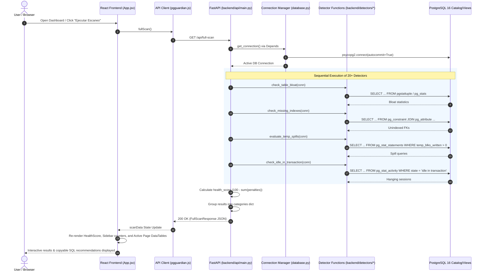

# Project Architecture & Codebase Map: PgGuardian

Document version: 1.0  
Date: November 2026  
Repository: `PgGuardian-Online`  
Author: Technical Audit & Architecture Review (/ponytail-audit)

---

## 1. Executive Summary & Core Purpose

### 1.1 Purpose and Value Proposition
**PgGuardian** is an automated, non-invasive B2B auditing and observability platform for PostgreSQL databases in production. It is designed specifically for small-to-midsize engineering teams (5–50 developers) lacking a dedicated Database Administrator (DBA), particularly within Mexico and Latin America.

Unlike heavyweight APM platforms (such as Datadog or pganalyze), PgGuardian provides:
1. **Targeted, actionable recommendations in Spanish**, complete with copy-pasteable SQL remediation scripts.
2. **Read-only, non-invasive catalog analysis**, minimizing operational overhead.
3. **Self-hosted and cloud-friendly deployment options**, addressing strict financial and data privacy regulations.
4. **Transparent, accessible pricing** ($49 USD/month per instance).

### 1.2 Academic & Evaluation Context
The codebase is structured around the **SIS2404** benchmark database (`tiendadb`), an e-commerce simulation designed to test automated detection engines against **18 intentionally planted performance and configuration defects (H01–H18)** across 5 operational pillars:
- **Indexes:** Missing foreign key indexes, duplicate indexes, unused indexes, missing partial indexes, missing covering indexes, obsolete statistics, and leading wildcard queries.
- **Bloat & Maintenance:** Table bloat, disabled autovacuum, and dead tuple accumulation.
- **Problematic Queries:** Sequential scans on large tables, low `work_mem` spills to disk (sort/hash spills), high execution time queries, and database-level temporary file generation.
- **Server Configuration:** Undersized `shared_buffers`, low `work_mem`, low `pg_stat_statements.max` query tracking limits, and disabled slow query logging (`log_min_duration_statement = -1`).
- **General Health:** Tables requiring partitioning / lacking data retention policies, and persistent idle-in-transaction connection leaks.

### 1.3 Core Technology Stack
| Layer | Technologies | Key Modules & Versions |
|---|---|---|
| **Database Engine** | PostgreSQL 16 | `pg_stat_statements`, `pgstattuple`, `pg_partman`, `pg_trgm` |
| **Backend API** | Python 3.12 | FastAPI `0.115.0`, Uvicorn `0.30.0`, Psycopg2-binary `2.9.9`, Pydantic `2.9.0` |
| **Frontend Dashboard** | React 19 (SPA) | React `19.2.6`, Vite `8.0.12`, React Router DOM `7.15.0` |
| **Marketing Landing** | React 18 (SPA) | React `18.3.1`, Vite `5.4.8`, Tailwind CSS `3.4.13` |
| **Containerization** | Docker & Compose | Multi-stage Dockerfiles, Docker Compose v2 |

---

## 2. Directory Structure & File Map

```text
PgGuardian-Online/
├── .env                                  # Local environment configuration
├── .gitignore                            # Git ignore patterns
├── docker-compose.yml                    # Multi-container orchestration (db, idle_tx, api, frontend)
├── Dockerfile                            # Custom PostgreSQL 16 image compiling pg_partman
├── postgresql.conf                       # Engine configuration with planted bottlenecks (H13-H16)
├── README.md                             # Public repository documentation & product overview
├── README_INSTRUCCIONES.md                 # Evaluation rubric and benchmark specifications
├── scratchpad.md                         # [This File] Master architecture map & technical audit
│
├── backend/
│   ├── Dockerfile.api                    # Container definition for FastAPI backend (Python 3.12-slim)
│   ├── requirements.txt                  # Python runtime dependencies
│   │
│   ├── api/                              # REST API presentation layer
│   │   ├── database.py                   # Psycopg2 connection generator & lifecycle manager
│   │   ├── main.py                       # Application entrypoint, CORS, router mounting, /full-scan
│   │   ├── schemas.py                    # Pydantic response models (DetectorResponse, FullScanResponse)
│   │   └── routers/                      # Category-specific REST endpoints
│   │       ├── __init__.py               # Package marker
│   │       ├── bloat.py                  # Endpoints for table bloat, autovacuum, and dead tuples
│   │       ├── config.py                 # Endpoints for server settings (work_mem, shared_buffers, etc.)
│   │       ├── health.py                 # Endpoints for partitioning and idle transactions
│   │       ├── indexes.py                # Endpoints for index audit (duplicates, unused, FKs, partial)
│   │       └── queries.py                # Endpoints for temp spills, seq scans, and slow queries
│   │
│   ├── detectors/                        # Core analysis & diagnosis engine (Catalog SQL queries)
│   │   ├── bloat.py                      # Bloat calculation (pgstattuple), autovacuum, dead tuples
│   │   ├── config.py                     # Memory/buffer evaluation (pg_settings)
│   │   ├── health.py                     # Partitioning candidates, idle-in-transaction detector
│   │   ├── indexes.py                    # FK index audit, duplicates, unused, partial, covering, wildcards
│   │   └── queries.py                    # Query performance, temp spills, EXPLAIN plan analyzer
│   │
│   └── discovery_queries/                # Reference SQL prototypes & catalog documentation
│       ├── bloat.sql                     # Raw queries for bloat detection
│       ├── config.sql                    # Raw queries for runtime settings
│       ├── health.sql                    # Raw queries for table sizes and transaction states
│       ├── indexes.sql                   # Raw queries for index diagnostics and catalog lookups
│       └── queries.sql                   # Raw queries for pg_stat_statements introspection
│
├── frontend/                             # React 19 SPA Dashboard
│   ├── Dockerfile                        # Node 20-alpine container running Vite dev server
│   ├── package.json                      # Frontend dependencies (React 19, React Router 7)
│   ├── vite.config.js                    # Vite build & server configuration
│   ├── index.html                        # HTML5 entrypoint
│   └── src/
│       ├── main.jsx                      # React DOM root render
│       ├── App.jsx                       # Root view, router configuration, 30s polling cycle
│       ├── App.css                       # Layout, topbar, and utility styles
│       ├── index.css                     # Global design tokens and theme variables
│       │
│       ├── api/
│       │   └── pgguardian.js             # API client functions wrapping fetch calls
│       │
│       ├── components/                   # Reusable UI widgets
│       │   ├── CategoryCard.jsx          # Category summary cards for Overview
│       │   ├── DataTable.jsx             # Generic data table with formatting & SQL copy block
│       │   ├── HealthScore.jsx           # Circular/numeric health score visualization
│       │   ├── SeverityBadge.jsx         # Severity tag (CRITICAL, HIGH, MEDIUM, LOW, OK)
│       │   ├── Sidebar.jsx               # Navigation bar with badge counters
│       │   └── SqlRecommendation.jsx     # Code block for copyable SQL remediation snippets
│       │
│       └── pages/                        # Route pages corresponding to audit categories
│           ├── Overview.jsx              # System health summary, score, and urgent findings
│           ├── BloatPage.jsx             # Table bloat and autovacuum tables
│           ├── ConfigPage.jsx            # Engine configuration evaluations
│           ├── HealthPage.jsx            # Partitioning and connection diagnostics
│           ├── IndexesPage.jsx           # Index recommendations and audit tables
│           └── QueriesPage.jsx           # Problematic queries, spills, and execution plans
│
├── landing/                              # Public marketing site
│   ├── package.json                      # Dependencies (React 18, Tailwind CSS 3)
│   ├── vite.config.js                    # Vite setup
│   └── src/components/LandingPage.jsx    # Complete single-page landing with pricing & features
│
├── init/                                 # PostgreSQL initialization scripts (auto-executed at boot)
│   ├── 01_schema.sql                     # Base e-commerce schema (8 relational tables)
│   ├── 02_seed_data.sql                  # Initial dataset (~100k orders, ~300k order items)
│   └── 03_plant_problems.sql             # Benchmark test suite planting issues H01 through H18
│
└── scripts/
    ├── scale_to_large.sql                # Scales database to ~18M rows / ~2 GB for load testing
    └── start_idle_tx.sh                  # Background daemon creating persistent idle transaction
```

---

## 3. Core Architecture & Components

```
+---------------------------------------------------------------------------------------+
|                                    PRESENTATION LAYER                                 |
|   Frontend (React 19 + Vite)                          Landing (React 18 + Tailwind)   |
|   - App.jsx (Global 30s Polling State)                - LandingPage.jsx               |
|   - Sidebar, DataTable, SqlRecommendation                                             |
|   - Category Pages (Bloat, Config, Health, Indexes, Queries)                          |
+-------------------------------------------+-------------------------------------------+
                                            | HTTP REST (/api/*)
                                            v
+---------------------------------------------------------------------------------------+
|                                  API GATEWAY & ENGINE                                 |
|   FastAPI Application (backend/api/main.py)                                           |
|   - CORS Middleware & Lifespan                                                        |
|   - Dependency Injection: get_connection() (backend/api/database.py)                  |
|   - Category Routers: bloat, config, health, indexes, queries                         |
|   - Aggregation Endpoint: /api/full-scan                                              |
|   - Dynamic Health Score Calculation Engine (0 - 100 with weighted penalties)         |
+-------------------------------------------+-------------------------------------------+
                                            | Internal Python Calls
                                            v
+---------------------------------------------------------------------------------------+
|                                    DETECTION CORE                                     |
|   backend/detectors/                                                                  |
|   ├── bloat.py     (check_table_bloat, check_disabled_autovacuum, check_dead_tuples)   |
|   ├── config.py    (evaluate_work_mem, evaluate_shared_buffers, pg_stat_statements)   |
|   ├── health.py    (check_partitioning_candidates, check_idle_in_transaction)         |
|   ├── indexes.py   (check_missing_indexes, check_duplicates, check_unused, wildcards)  |
|   └── queries.py   (evaluate_temp_spills, detect_seq_scans, evaluate_top_time)        |
+-------------------------------------------+-------------------------------------------+
                                            | SQL Queries (Catalogs & Views)
                                            v
+---------------------------------------------------------------------------------------+
|                                    DATABASE LAYER                                     |
|   PostgreSQL 16 Engine                                                                |
|   - System Views: pg_stat_user_tables, pg_stat_user_indexes, pg_stat_activity         |
|   - System Catalogs: pg_class, pg_index, pg_constraint, pg_settings, pg_stats         |
|   - Extensions: pg_stat_statements, pgstattuple, pg_partman, pg_trgm                  |
+---------------------------------------------------------------------------------------+
```

### 3.1 Database Layer & Target Engine
The system interrogates the internal metadata of PostgreSQL. It relies primarily on:
- **`pg_catalog`**: Structural analysis (`pg_class`, `pg_attribute`, `pg_namespace`, `pg_index`, `pg_constraint`, `pg_settings`).
- **`pg_stat` subsystem**: Dynamic runtime metrics (`pg_stat_user_tables`, `pg_stat_user_indexes`, `pg_stat_database`, `pg_stat_activity`).
- **`pg_stat_statements`**: Query performance counters (`calls`, `total_exec_time`, `temp_blks_written`, `temp_blks_read`).
- **`pgstattuple`**: Physical page tuple density and bloat quantification.
- **`pg_partman`**: Partition maintenance and structure verification.

### 3.2 Detector Engine (`backend/detectors/`)
Each detector is a pure Python function receiving a `psycopg2` connection, issuing a specific SQL query, and returning a list of dictionaries with standardized fields:
- `evidence`: Plain-text justification detailing the exact metric, threshold breached, and affected table/query.
- `sql_recommendation` / `sql_fix`: Ready-to-execute SQL command (e.g., `CREATE INDEX CONCURRENTLY`, `VACUUM FULL`, `ALTER SYSTEM SET`).
- Metadata attributes (`severity`, `table_name`, `calls`, `pct`, etc.).

#### Coverage of Benchmark Problems (H01–H18):
| Benchmark ID | Problem Planted | Detector Module | Primary Detection Function |
|---|---|---|---|
| **H01** | Missing index on `orders.customer_id` (FK) | `backend/detectors/indexes.py` | `check_missing_indexes` |
| **H02** | Duplicate index on `products(category_id)` | `backend/detectors/indexes.py` | `check_duplicate_indexes` |
| **H03** | Unused index on `customers.birth_date` | `backend/detectors/indexes.py` | `check_unused_indexes` |
| **H04** | Missing partial index on `orders(status)` | `backend/detectors/indexes.py` | `check_missing_partial_indexes` |
| **H05** | Missing covering index on report queries | `backend/detectors/indexes.py` | `check_covering_index_candidates` |
| **H06** | Severe table bloat on `event_log` (~40%) | `backend/detectors/bloat.py` | `check_table_bloat` |
| **H07** | Autovacuum disabled on `inventory` | `backend/detectors/bloat.py` | `check_disabled_autovacuum` |
| **H08** | Accumulated dead tuples on `reviews` (~50%)| `backend/detectors/bloat.py` | `check_dead_tuples` |
| **H09** | Seq scan query on `orders` due to missing FK | `backend/detectors/queries.py` | `detect_seq_scan_queries` |
| **H10** | Stale planner statistics on `products` | `backend/detectors/indexes.py` | `check_obsolete_stats` |
| **H11** | Sort spill to disk (`work_mem` too low) | `backend/detectors/queries.py` | `evaluate_temp_spills`, `evaluate_explain_spills` |
| **H12** | Leading wildcard search (`LIKE '%...%'`) | `backend/detectors/indexes.py` | `check_leading_wildcard_searches` |
| **H13** | `shared_buffers` undersized (128MB) | `backend/detectors/config.py` | `evaluate_shared_buffers` |
| **H14** | `work_mem` undersized (4MB) | `backend/detectors/config.py` | `evaluate_work_mem` |
| **H15** | `pg_stat_statements.max` too low (100) | `backend/detectors/config.py` | `evaluate_pg_stat_statements_max`, `check_pg_stat_statements_limit` |
| **H16** | Slow query logging disabled (`log_min_duration_statement = -1`) | `backend/detectors/config.py` | `check_slow_query_logging`, `evaluate_log_min_duration_statement` |
| **H17** | Persistent idle in transaction connection | `backend/detectors/health.py` | `check_idle_in_transaction` |
| **H18** | Unbounded table growth / no retention | `backend/detectors/health.py` | `check_partitioning_candidates` |

### 3.3 Scoring & Heuristic Penalty Engine (`backend/api/main.py`)
The health score is computed dynamically in `/api/full-scan` by starting at 100 points and applying weighted deductions based on findings:
```python
penalty = 0
# Bloat penalties
penalty += len(bloat_warnings) * 5
penalty += len(disabled_autovacuum) * 10
penalty += len(dead_warnings) * 5

# Config penalties
penalty += len(work_mem_eval) * 8
penalty += len(shared_buffers_eval) * 8
penalty += len(pg_stat_max_eval) * 5
penalty += len(pg_stat_limit) * 3
penalty += len(slow_query_logging) * 5

# Health penalties
penalty += len(partition_candidates) * 2
penalty += len(idle_in_transaction) * 10

# Indexes penalties
penalty += len(missing_indexes) * 6
penalty += len(duplicate_indexes) * 4
penalty += len(unused_indexes) * 3
penalty += len(missing_partial) * 3
penalty += len(obsolete_stats) * 5
penalty += len(wildcard_searches) * 3
penalty += len(covering_candidates) * 2

# Queries penalties
penalty += len([s for s in temp_spills if s.get("severity") == "HIGH"]) * 8
penalty += len([s for s in temp_spills if s.get("severity") == "MEDIUM"]) * 5
penalty += len(seq_scans) * 4
penalty += len(top_time_queries) * 4
penalty += len(db_temp_usage) * 5
penalty += len(explain_spills) * 6

health_score = max(0, 100 - penalty)
```

---

## 4. End-to-End Data & Execution Flow

### 4.1 Initialization & Bootstrapping Sequence
1. **Container Launch (`docker compose up -d`):**
   - Service `db` initializes:
     - Installs `pg_partman` via `Dockerfile`.
     - Mounts `postgresql.conf` with misconfigurations into `/etc/postgresql/postgresql.conf`.
     - Executes entrypoint scripts in `/docker-entrypoint-initdb.d` in alphabetical order:
       1. `01_schema.sql`: Tables and relations created; enables `pg_stat_statements`.
       2. `02_seed_data.sql`: Generates synthetic data.
       3. `03_plant_problems.sql`: Updates, deletes, and queries to register stats and create bloat.
     - Performs health check: `pg_isready -U tienda_user -d tiendadb`.
   - Service `idle_tx` waits for `db` to become healthy, then runs `start_idle_tx.sh`, opening a transaction and holding an indefinite sleep lock.
   - Service `api` waits for `db` healthcheck, boots FastAPI via `uvicorn api.main:app`.
   - Service `frontend` boots Vite dev server on port `5173`.

### 4.2 Full Diagnostic Scan Flow (`/api/full-scan`)


### 4.3 Automated Polling Loop
- `frontend/src/App.jsx` registers an interval with `POLL_INTERVAL = 30000` (30 seconds).
- Every 30 seconds, if `autoRefresh` is true, `runScan()` is re-invoked, maintaining fresh telemetry without requiring full page reloads.

---

## 5. Configuration & Environment

### 5.1 Environment Variables
Configured in `.env` at repository root and injected into container services:
| Variable | Default Value (Local) | Docker Service Consumer | Description |
|---|---|---|---|
| `DB_NAME` | `tiendadb` | `db`, `api` | Name of the target database |
| `DB_USER` | `tienda_user` | `db`, `api` | Database connection role |
| `DB_PASSWORD` | `tienda_pass` | `db`, `api` | Role authentication secret |
| `DB_PORT` | `5433` (external) / `5432` | `db`, `api` | Port mapped to host |
| `DB_HOST` | `db` (internal Docker network) | `api` | Database host hostname |
| `VITE_API_URL`| `http://localhost:8000/api` | `frontend` | Base endpoint URL for the frontend |

### 5.2 Network Topology & Port Bindings
- `frontend`: Exposes `5173:5173` (Vite dev server).
- `api`: Exposes `8000:8000` (Uvicorn / FastAPI). Swagger UI available at `http://localhost:8000/docs`.
- `db`: Exposes host port `5433` mapped to internal `5432` to avoid conflicts with local PostgreSQL instances.
- `idle_tx`: No exposed ports; connects over internal Docker bridge network to `db:5432`.

### 5.3 Local Development Setup
```bash
# 1. Clone repository
git clone https://github.com/luiselodeon/PgGuardian.git
cd PgGuardian

# 2. Verify or create .env file
cat <<EOF > .env
DB_NAME=tiendadb
DB_USER=tienda_user
DB_PASSWORD=tienda_pass
DB_PORT=5433
EOF

# 3. Build and launch all services
docker compose up -d

# 4. Monitor initial seeding progress (takes ~1-2 min)
docker compose logs -f db
# Wait until: "TiendaDB v1.0 ready with 18 planted problems"

# 5. Access application
# Frontend Dashboard: http://localhost:5173
# API Swagger Docs:   http://localhost:8000/docs
```

---

## 6. Key Patterns, Constraints & Technical Debt

### 6.1 Architectural Patterns
1. **Catalog Introspection Pattern:** All health data is extracted directly from PostgreSQL system catalogs and statistic views, avoiding heavy runtime tracing agents.
2. **Defensive Safe-Runner Pattern:** `_safe_run` wraps detector invocations in `backend/api/main.py`, converting runtime exceptions into error payloads rather than aborting the entire scan.
3. **Normalized Prescription Pattern:** Findings are paired with deterministic SQL remediation scripts (`sql_recommendation`, `sql_fix`), enabling immediate remediation.
4. **Virtual Column Rendering in Frontend:** `DataTable.jsx` dynamically binds `sql_combined` across varied detector key formats (`sql_recommendation`, `sql_fix`, `suggested_action`), ensuring consistent UI presentation.

---

### 6.2 Ranked Technical Audit Findings (Ponytail Audit)

Assumed expected load: **1 to 5 concurrent administrators running diagnostic scans against production PostgreSQL instances hosting 10 to 1,000 queries per second**.

#### Group A: MUST FIX (Bugs, Security Risks, Data Integrity)

1. **Broken partition detection logic flags 100% of tables** (`backend/detectors/health.py:L50-66`)
   - **What this is:** `check_partitioning_candidates` queries `pg_stat_user_tables` to find large or unpartitioned tables lacking retention policies.
   - **Problem:** The `WHERE` clause combines criteria using `OR` instead of `AND`: `WHERE c.relkind = 'r' OR c.relispartition = false OR ...`. Because every normal table in PostgreSQL satisfies `c.relkind = 'r'`, this query returns every single table in the database (including 50-row lookup tables like `categories`) as a candidate for partitioning.
   - **Fix:** Require tables to be standard tables (`c.relkind = 'r' AND c.relispartition = false`) AND meet at least one threshold (size > 500MB OR inserts > 100k):
     ```sql
     WHERE c.relkind = 'r' 
       AND NOT c.relispartition
       AND (pg_total_relation_size(stat.relid) > 500 * 1024 * 1024 OR stat.n_tup_ins > 100000)
     ```
   - **If we skip it:** Every scan produces massive false positives, violating the rubric penalty (-0.5 pts per false positive) and recommending complex table partitioning where completely inappropriate.

2. **Hardcoded database username disables idle transaction detector** (`backend/detectors/health.py:L158`)
   - **What this is:** `check_idle_in_transaction` checks `pg_stat_activity` for connections lingering in transaction.
   - **Problem:** The query has a hardcoded filter: `AND usename = 'tienda_user';`. When deployed against any database with a different user, the detector returns zero findings regardless of how many hanging transactions exist.
   - **Fix:** Remove the hardcoded username filter and exclude only background/system processes: `AND usename NOT IN ('postgres') AND backend_type = 'client backend'`.
   - **If we skip it:** The detector completely fails on real client databases or the professor's Demo Day v2 benchmark.

3. **Destructive DDL and privilege escalation in "read-only" tool** (`backend/detectors/bloat.py:L29`, `backend/detectors/health.py:L31-33`)
   - **What this is:** PgGuardian advertises itself as a non-invasive, strictly read-only auditor.
   - **Problem:** `check_table_bloat` executes `CREATE EXTENSION IF NOT EXISTS pgstattuple;` and `check_partitioning_candidates` executes `CREATE SCHEMA IF NOT EXISTS partman; CREATE EXTENSION IF NOT EXISTS pg_partman SCHEMA partman;`. In a true read-only connection with standard credentials, these queries immediately throw permission denied errors because extension creation requires superuser privileges.
   - **Fix:** Query `pg_extension` first; if the extension is absent, return a descriptive warning finding instructing the DBA to install it, or fall back to catalog-only estimations.
   - **If we skip it:** The application crashes or fails in any production environment adhering to the principle of least privilege.

4. **Dynamic SQL injection and query execution in `evaluate_single_explain`** (`backend/detectors/queries.py:L354-367`)
   - **What this is:** Validates whether slow queries from `pg_stat_statements` suffer sort/hash disk spills by generating an execution plan.
   - **Problem:** It substitutes `$1` with `NULL` and formats the string directly into `EXPLAIN (ANALYZE, BUFFERS) {sanitized_query}`. `EXPLAIN ANALYZE` actually executes the query on the database. If a user query invokes a function with side effects (e.g. data modification or long sleep), running it during audit triggers side effects and places locks on tables.
   - **Fix:** Use standard `EXPLAIN` without `ANALYZE` (read-only plan estimation) or restrict plan analysis to verified read-only statements using parameterized statements.
   - **If we skip it:** Audit scans can execute destructive user functions or cause production latency spikes.

5. **`EXPLAIN (GENERIC_PLAN)` crash on non-parameterized queries** (`backend/detectors/queries.py:L458-498`)
   - **What this is:** `detect_seq_scan_queries` uses Postgres 16's `GENERIC_PLAN` option to inspect top query plans.
   - **Problem:** In PostgreSQL, `EXPLAIN (GENERIC_PLAN)` throws an error if executed on a query that has no parameter placeholders (`$1`). The exception is caught by a blanket `try/except` which performs a `conn.rollback()`, silently skipping analysis for all static queries in the top 20 list.
   - **Fix:** Check whether the query string contains `$1` before passing `(GENERIC_PLAN)`; otherwise, pass a standard `EXPLAIN` without parameters.
   - **If we skip it:** Static queries with severe sequential scans are never inspected.

---

#### Group B: SHOULD FIX (Performance, Redundancy, Scale)

6. **Sequential blocking execution in `/api/full-scan`** (`backend/api/main.py:L129-173`)
   - **What this is:** `/api/full-scan` executes over 20 detector functions sequentially on a single database connection.
   - **Problem:** If individual queries take 1–2 seconds (or if `EXPLAIN ANALYZE` waits on locks), the cumulative execution time exceeds 20–30 seconds, blocking the request thread and causing frontend timeouts.
   - **Fix:** Concurrently execute independent detector queries using Python `asyncio` or a thread pool with dedicated connections.
   - **If we skip it:** The dashboard feels sluggish and full scans frequently time out under production loads.

7. **No database connection pooling** (`backend/api/database.py:L12-36`)
   - **What this is:** Database connection manager for FastAPI.
   - **Problem:** `get_connection()` creates a brand-new TCP socket connection via `psycopg2.connect()` and closes it on every single request.
   - **Fix:** Use `psycopg2.pool.ThreadedConnectionPool` or `asyncpg` to maintain a persistent connection pool of 5–10 reusable connections.
   - **If we skip it:** High latency per request and PostgreSQL connection exhaustion when multiple dashboard users are active.

8. **Duplicate detector execution and double score penalty for H15** (`backend/api/main.py:L149-150`, `L342-343`)
   - **What this is:** Detection of low `pg_stat_statements.max` setting.
   - **Problem:** Both `evaluate_pg_stat_statements_max` and `check_pg_stat_statements_limit` in `backend/detectors/config.py` check the identical condition (`s.setting < 1000`). Both are called in `full_scan`, returning duplicate findings and penalizing the health score twice (-5 and -3 = -8 points).
   - **Fix:** Remove one of the duplicate functions and consolidate into `check_pg_stat_statements_limit`.
   - **If we skip it:** Distorts the health score calculation and displays duplicated cards on the configuration page.

9. **Identical `_serialize` helper copy-pasted in 6 files** (`backend/api/main.py`, `backend/api/routers/*.py`)
   - **What this is:** Helper function to convert `psycopg2.extras.RealDictRow` and `Decimal` values into standard JSON-serializable dictionaries.
   - **Problem:** Exactly 12 lines of serialization code are copy-pasted across `main.py`, `bloat.py`, `config.py`, `health.py`, `indexes.py`, and `queries.py`.
   - **Fix:** Move `_serialize` into a shared utility file (e.g. `backend/api/utils.py` or `backend/api/schemas.py`) and import it.
   - **If we skip it:** Any serialization bugfix or optimization must be manually replicated across 6 separate files.

10. **Zero automated test coverage** (Workspace root)
    - **What this is:** Test harness for backend detector SQL and API endpoints.
    - **Problem:** The repository has zero test files (`pytest`, `unittest`, or frontend tests). A small SQL syntax error in any detector will crash the `/full-scan` endpoint without warning until manually verified.
    - **Fix:** Add a minimal `pytest` suite with mock catalog fixtures or a Dockerized test runner validating that all detector functions return valid schemas.
    - **If we skip it:** High regression risk whenever queries or threshold algorithms are adjusted.

---

#### Group C: NICE TO HAVE (Lean Code, Cleanup)

11. **Dead/unused individual REST endpoints in frontend client** (`frontend/src/api/pgguardian.js:L29-62`)
    - **What this is:** 22 individual API endpoint wrappers defined in the frontend client.
    - **Problem:** The React dashboard exclusively uses `fullScan()`. The remaining 22 functions and their backend router counterparts are completely unreferenced in the UI.
    - **Fix:** Keep the consolidated `/full-scan` endpoint as the primary interface, or document the individual endpoints as public developer API.
    - **If we skip it:** Extra endpoints to maintain without clear UI consumers.

12. **React version divergence between dashboard and landing** (`frontend/package.json`, `landing/package.json`)
    - **What this is:** Package dependencies for the two frontend workspaces.
    - **Problem:** `frontend` runs React 19 (`^19.2.6`), while `landing` runs React 18 (`^18.3.1`).
    - **Fix:** Unify both applications on a single React version or consolidate into a monorepo workspace.
    - **If we skip it:** Slight maintenance overhead across two separate node environments.

13. **Hardcoded credentials in `start_idle_tx.sh`** (`scripts/start_idle_tx.sh:L11`)
    - **What this is:** Helper script simulating an abandoned transaction container.
    - **Problem:** Hardcodes `PGPASSWORD=tienda_pass` and user `tienda_user` rather than reading environment variables.
    - **Fix:** Use `${DB_PASSWORD}` and `${DB_USER}` with defaults.
    - **If we skip it:** Fails if credentials in `.env` are customized.

---

## 7. Audit Summary & Verdict

- **Verdict:** Functional proof-of-concept with high domain accuracy against PostgreSQL catalogs, but currently hindered by critical logic bugs (such as 100% false positives on partitioning candidates), non-read-only DDL execution, and lack of connection pooling.
- **Lean Potential:** ~180 lines of duplicated code (repetitive `_serialize` declarations and duplicate config detectors) and 1 unused dependency can be eliminated immediately.
- **Verification Note:** All 18 benchmark issues (H01–H18) have corresponding detection logic mapped, but generic resilience requires removing hardcoded filters (`usename = 'tienda_user'`) prior to testing against unexpected database environments.

---

## RF-01.1 y RF-01.2 - Registro de Cambios y Decisiones Técnicas

### 1. Archivos Creados y Modificados

#### Backend (FastAPI)
- **`backend/requirements.txt`** *(modificado)*: Se agregó `python-multipart==0.0.20`, requerido por FastAPI/Starlette para procesar peticiones `multipart/form-data` con `UploadFile` y `Form`.
- **`backend/api/schemas.py`** *(modificado)*: Se añadieron los modelos Pydantic `AnalysisFileSummary` y `AnalysisCreateResponse` para tipar la respuesta de `POST /api/analyses`.
- **`backend/api/routers/analyses.py`** *(creado)*: Nuevo router con prefijo `/api/analyses` y endpoint `POST /api/analyses`, incluyendo las funciones de validación `_parse_execution_order` y `_read_and_validate_file`.
- **`backend/api/main.py`** *(modificado)*: Se importó y montó `analyses_router.router` dentro de la aplicación FastAPI sin alterar los detectores ni endpoints existentes de TiendaDB.
- **`backend/tests/test_analyses.py`** *(creado)*: Suite de pruebas unitarias con `unittest` (`IsolatedAsyncioTestCase`) que verifica carga válida, reordenamiento, rechazo por cantidad, extensión inválida, UTF-8 inválido, límites de peso (10 MB / 25 MB) y parámetro `order` malformado.

#### Frontend (React 19 + Vite)
- **`frontend/src/api/pgguardian.js`** *(modificado)*: Se agregó la función `createAnalysis(files, order)` que envía `FormData` vía `POST ${API_BASE}/analyses` y propaga el campo `detail` de errores HTTP en español.
- **`frontend/src/components/NewAnalysisModal.jsx`** *(creado)*: Modal accesible con selector múltiple y drag-and-drop para archivos `.sql`, validación en cliente, lista reordenable (botones `Subir`/`Bajar` y arrastre de filas) y vista de resumen tras recibir `201 Created`.
- **`frontend/src/components/NewAnalysisModal.css`** *(creado)*: Estilos del modal, dropzone, cola ordenada y tabla de resultados usando las variables de diseño existentes en `frontend/src/index.css`.
- **`frontend/src/App.jsx`** *(modificado)*: Se incorporó el botón **«Nuevo análisis»** en la barra superior (`.top-bar-actions`) y el montaje condicional de `NewAnalysisModal`.
- **`frontend/src/App.css`** *(modificado)*: Se agregó la clase `.new-analysis-button` alineada con la paleta y jerarquía visual de `.scan-button`.

### 2. Decisiones Técnicas y Alineación Arquitectónica
- **Desacoplamiento de `app_db` y `sandbox_db` (alcance RF-01.1 / RF-01.2):** Dado que la creación de tablas en `app_db` (RF-02) y la ejecución aislada en `sandbox_db` (RF-01.4) pertenecen a incrementos separados, `POST /api/analyses` valida los scripts en memoria y retorna `201 Created` con un identificador UUID temporal, estado `"validado"` y el resumen ordenado de los archivos, manteniendo intacta la compatibilidad con TiendaDB (RNF-05) y sin introducir dependencias de base de datos ni `pglast` (RF-01.3).
- **Lectura por bloques (*streaming*) en FastAPI:** `_read_and_validate_file` lee cada `UploadFile` en fragmentos de 1 MB (`READ_CHUNK_BYTES`) acumulando el tamaño individual y total en curso. Esto evita cargar en memoria archivos sobredimensionados antes de rechazarlos con `413` y asegura el cierre de descriptores en un bloque `finally`.
- **Preservación explícita del orden secuencial:** El endpoint recibe el parámetro opcional `order` como `Form` (arreglo JSON de índices base 0, o enteros separados por coma) además del orden del arreglo `files`. El frontend envía los archivos ya reordenados junto con `order = [0, 1, ...]` y el backend reasigna posiciones consecutivas `1..N` en la respuesta.
- **Validación dual Cliente + Servidor en React:** El modal valida extensión `.sql`, límite de 5 archivos, ≤ 10 MB individuales y ≤ 25 MB acumulados antes de enviar; la validación estricta de codificación UTF-8 se ejecuta en el backend (además de revalidar tamaño, cantidad, extensión y orden en el límite de confianza), permitiendo feedback inmediato en UI sin ocultar rechazos `422` por codificación inválida.
- **Sin dependencias externas nuevas en Frontend:** El reordenamiento usa estado nativo de React con controles de teclado/clic (`↑` / `↓`) y eventos HTML5 Drag-and-Drop, evitando librerías externas innecesarias.

### 3. Reglas de Validación Aplicadas
1. **Cantidad de archivos:** Mínimo `1` (`MIN_FILES = 1`) y máximo `5` (`MAX_FILES = 5`) por análisis.
2. **Extensión:** Solo archivos con sufijo `.sql` (insensible a mayúsculas, verificando nombre base no vacío mediante `PurePosixPath(filename).suffix.lower() == ".sql"` en backend y comprobación equivalente en cliente).
3. **Tamaño de archivo e impacto acumulado:**
   - Individual: máximo `10 * 1024 * 1024` bytes (10 MB) por archivo (`MAX_FILE_SIZE_BYTES`).
   - Combinado: máximo `25 * 1024 * 1024` bytes (25 MB) sumando todos los archivos de la petición (`MAX_TOTAL_SIZE_BYTES`).
4. **Codificación UTF-8 estricta:** Decodificación estricta `raw_bytes.decode("utf-8")` sin reemplazo ni tolerancia de bytes inválidos.
5. **Orden de ejecución:** El parámetro opcional `order` debe representar una permutación exacta y sin duplicados ni booleanos de `0 .. len(files) - 1`.

### 4. Manejo de Errores y Códigos HTTP
Todos los mensajes de error se devuelven en español bajo el campo estándar `detail` de FastAPI (cumpliendo RNF-04):
- **`201 Created`:** Todos los archivos cumplen las reglas; devuelve `AnalysisCreateResponse` con `id`, `status: "validado"`, `message`, `file_count`, `total_size_bytes`, `files` (ordenados `1..N` con nombre, tamaño en bytes, codificación `"utf-8"` y conteo de líneas) y `created_at`.
- **`400 Bad Request`:** Menos de 1 archivo o archivo sin nombre válido, más de 5 archivos, o parámetro `order` malformado, con longitud incompatible o índices inválidos/duplicados.
- **`413 Content Too Large`:** Cualquier archivo supera 10 MB o el peso acumulado supera 25 MB.
- **`422 Unprocessable Entity`:** Extensión distinta de `.sql` o contenido con bytes no decodificables en UTF-8 estricto.

---

## RF-01.3 y RF-01.4 - Registro de Implementación, Seguridad y Sandbox

### 1. Archivos Creados y Modificados
- **`.env`** *(modificado)*: Se añadieron las variables dedicadas para el servidor sandbox (`SANDBOX_DB_NAME`, `SANDBOX_DB_ADMIN_USER`, `SANDBOX_DB_ADMIN_PASSWORD`, `SANDBOX_DB_EXEC_USER`, `SANDBOX_DB_EXEC_PASSWORD`), desacopladas de `DB_*` (TiendaDB / `app_db`).
- **`docker-compose.yml`** *(modificado)*: Se incorporó el servicio aislado `sandbox_db` (`postgres:16`, contenedor `pgguardian_sandboxdb`, volumen `sandbox_data`, sin puertos públicos expuestos ni scripts de `init/`), y se inyectaron las variables `SANDBOX_DB_*` y la dependencia `depends_on: sandbox_db (service_healthy)` en el servicio `api`.
- **`backend/requirements.txt`** *(modificado)*: Se agregó `pglast==6.17` (parser nativo de PostgreSQL 16 vía `libpg_query`).
- **`backend/services/__init__.py`** *(creado)*: Marcador de paquete para la capa de servicios del backend.
- **`backend/services/sql_validator.py`** *(creado)*: Servicio de análisis estático AST con `pglast` (`validate_sql_script`, `validate_scripts`, `_SafetyVisitor`, `SqlValidationError`, `ParsedStatement`).
- **`backend/services/sandbox_runner.py`** *(creado)*: Servicio de aprovisionamiento y ejecución aislada en `sandbox_db` (`execute_in_sandbox`, `_provision_sandbox_db`, `_ensure_unprivileged_role`, `_drop_sandbox_db`, `SandboxExecutionError`, `SandboxResult`).
- **`backend/api/schemas.py`** *(modificado)*: Se extendió `AnalysisCreateResponse` con `sandbox_db_name`, `executed_statements` y `execution_time_ms`.
- **`backend/api/routers/analyses.py`** *(modificado)*: Se integró la secuencia RF-01.1/01.2 → RF-01.3 (`validate_scripts`) → RF-01.4 (`run_in_threadpool(execute_in_sandbox, ...)`) antes de devolver `201 Created` (`status: "ejecutado"`).
- **`frontend/src/api/pgguardian.js`** y **`frontend/src/components/NewAnalysisModal.jsx`** *(modificados)*: Soporte para formatear errores estructurados (`detail` con archivo y línea) y mostrar `sandbox_db_name`, `executed_statements` y `execution_time_ms` tras la ejecución.
- **`backend/tests/test_sql_validator.py`** y **`backend/tests/test_sandbox_runner.py`** *(creados)* + **`backend/tests/test_analyses.py`** *(actualizado)*: Cobertura unitaria para reglas AST, aislamiento de configuración, fail-fast, limpieza y timeout de 120 s.

### 2. Nodos de `pglast` Inspeccionados y Reglas AST (RF-01.3)
El validador utiliza `pglast.parse_sql`, `pglast.parser.scan` (cálculo exacto de línea y fragmento omitiendo comentarios iniciales sin usar expresiones regulares) y `pglast.visitors.Visitor` sobre cada `RawStmt`:

| Regla (`rule`) | Nodos AST de `pglast` inspeccionados | Condición de rechazo |
|---|---|---|
| `alter_system` | `AlterSystemStmt` | Rechazo incondicional (`ALTER SYSTEM SET/RESET`). |
| `copy_program` / `copy_file` | `CopyStmt` | Rechazo cuando `is_program == True` o `filename is not None` (permite `COPY ... FROM STDIN`). |
| `role_management` | `CreateRoleStmt`, `AlterRoleStmt`, `AlterRoleSetStmt`, `DropRoleStmt`, `GrantRoleStmt`, `VariableSetStmt` | Rechazo de creación/alteración/eliminación/asignación de roles y `SET ROLE` / `SET SESSION AUTHORIZATION`. |
| `critical_privilege` | `GrantStmt`, `AlterOwnerStmt` | Rechazo sobre `OBJECT_DATABASE`, `OBJECT_TABLESPACE`, `OBJECT_FDW`, `OBJECT_FOREIGN_SERVER`, `OBJECT_PARAMETER_ACL` o esquemas del sistema (`pg_*`, `information_schema`). |
| `database_management` | `CreatedbStmt`, `DropdbStmt`, `AlterDatabaseStmt`, `AlterDatabaseSetStmt`, `AlterDatabaseRefreshCollStmt`, `AlterOwnerStmt`, `RenameStmt` | Rechazo de cualquier creación, eliminación, cambio de dueño, renombrado o `ALTER DATABASE`. |
| `system_object_management` | `CreateTableSpaceStmt`, `DropTableSpaceStmt`, `CreateFdwStmt`, `AlterFdwStmt`, `CreateForeignServerStmt`, `AlterForeignServerStmt`, `CreateUserMappingStmt`, `DropStmt` | Rechazo de tablespaces, wrappers/servidores externos y `DROP` sobre lenguajes/FDW/servidores. |
| `disallowed_extension` | `CreateExtensionStmt`, `AlterExtensionStmt`, `AlterExtensionContentsStmt` | Bloqueo salvo que `extname` pertenezca a `ALLOWED_EXTENSIONS` (`uuid-ossp`, `pgcrypto`, `pg_trgm`, `citext`, `hstore`, `unaccent`, `btree_gin`, `btree_gist`). |
| `untrusted_language` | `CreatePLangStmt`, `CreateFunctionStmt`, `DoStmt` | Rechazo de `CREATE LANGUAGE` y de funciones/bloques `DO` cuyo parámetro `language` no pertenezca a `ALLOWED_FUNCTION_LANGUAGES` (`sql`, `plpgsql`). |

### 3. Aislamiento, Privilegios del Rol y Timeout de 120 s (RF-01.4)
- **Desacoplamiento total:** `_get_sandbox_config()` lee exclusivamente `SANDBOX_DB_*` y nunca invoca `api.database.get_connection()` ni usa variables `DB_*`.
- **Aprovisionamiento por análisis:** Se genera una base única `sandbox_<uuid_hex>` mediante la conexión administrativa (`SANDBOX_DB_ADMIN_USER`), se revoca el acceso `PUBLIC` sobre la base (`REVOKE ALL ON DATABASE ... FROM PUBLIC`) y, dado el endurecimiento de PostgreSQL 15/16 sobre el esquema `public`, se transfiere la propiedad del esquema `public` de esa base efímera al rol ejecutor.
- **Control de privilegios:** `_ensure_unprivileged_role()` crea o reasegura `SANDBOX_DB_EXEC_USER` con `LOGIN NOSUPERUSER NOCREATEDB NOCREATEROLE NOINHERIT NOREPLICATION`. La ejecución de scripts se realiza exclusivamente con una conexión independiente bajo ese rol hacia `sandbox_<uuid_hex>`.
- **Timeout global de 120 s y fail-fast:** `execute_in_sandbox` mantiene un reloj monotónico (`deadline = start + 120s`) y ejecuta cada sentencia validada en orden calculando `remaining_ms = int((deadline - time.monotonic()) * 1000)` y aplicando `SET statement_timeout = %s` antes de cada sentencia (impidiendo evasiones mediante `SET statement_timeout = 0` en un script). Al primer error SQL o vencimiento del límite (`57014`), aborta de inmediato, cierra la conexión ejecutora y ejecuta `DROP DATABASE IF EXISTS <sandbox> WITH (FORCE)` para evitar bases huérfanas.

### 4. Formato de Error Estructurado
Ante fallos de sintaxis o AST (`422`), errores SQL en sandbox (`422`), timeout de 120 s (`408`) o indisponibilidad de `sandbox_db` (`503`), FastAPI devuelve el campo `detail` estructurado en español:
```json
{
  "code": "SQL_AST_BLOCKED | SQL_SYNTAX_ERROR | SANDBOX_EXECUTION_ERROR | SANDBOX_TIMEOUT | SANDBOX_CONNECTION_ERROR",
  "message": "Descripción contextualizada en español",
  "filename": "archivo.sql",
  "line": 12,
  "rule": "alter_system",
  "statement": "ALTER SYSTEM SET work_mem = '64MB'",
  "pgcode": "42P01",
  "pg_error": "Mensaje original de PostgreSQL (cuando aplica en ejecución)"
}
```


